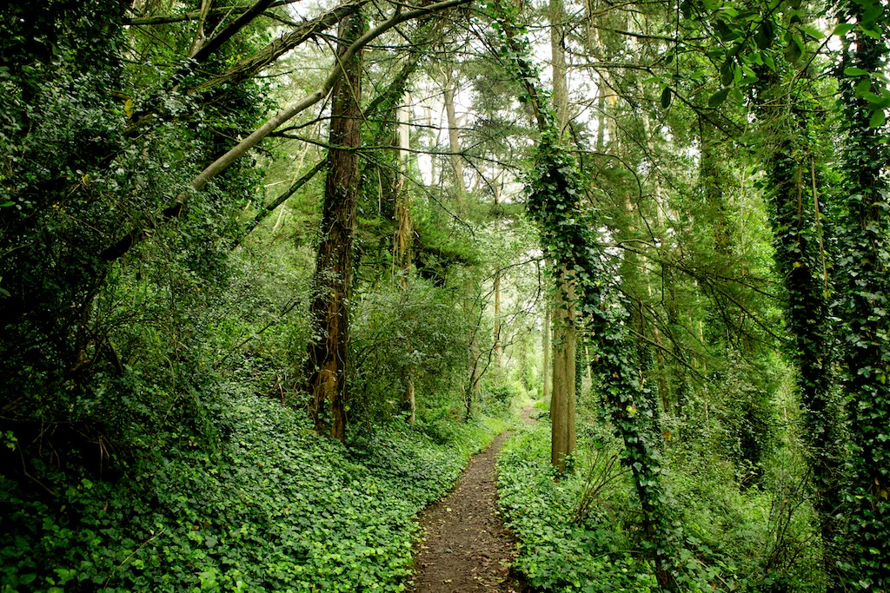
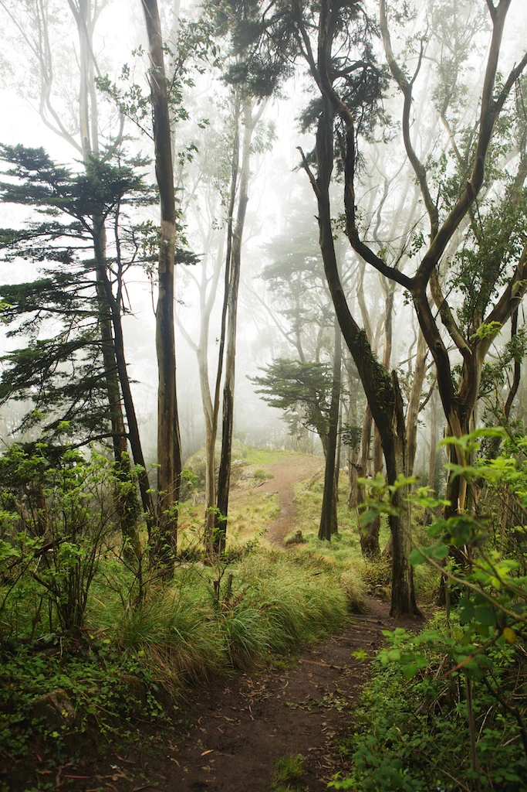
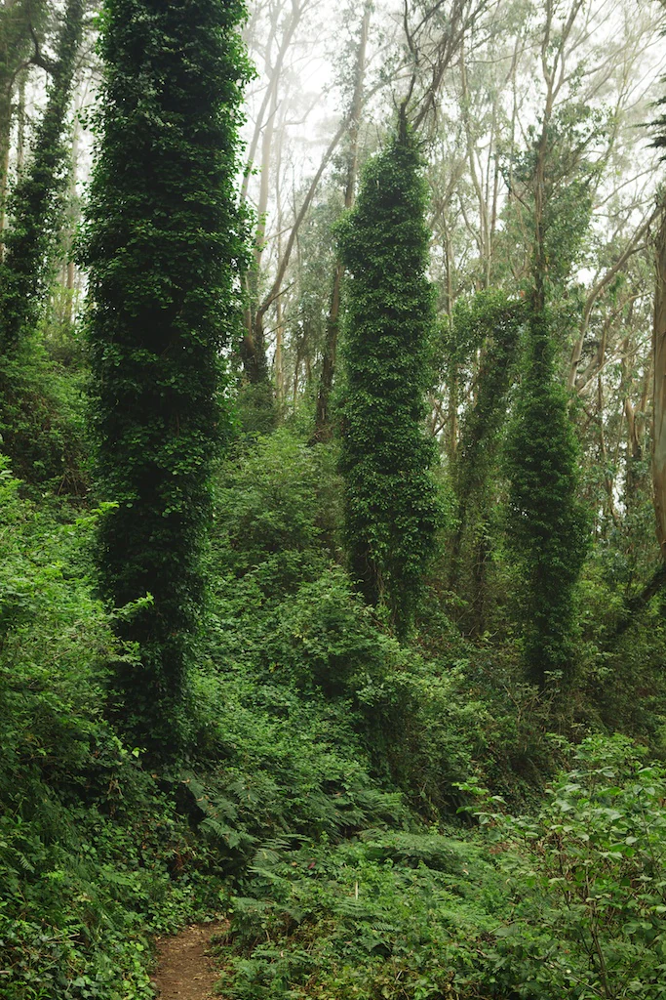
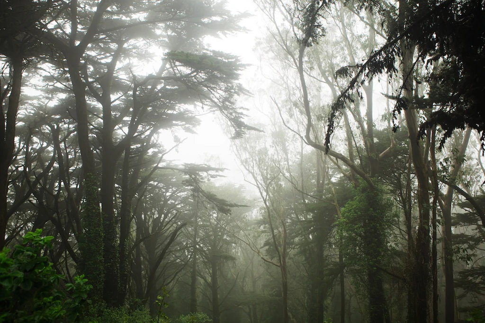
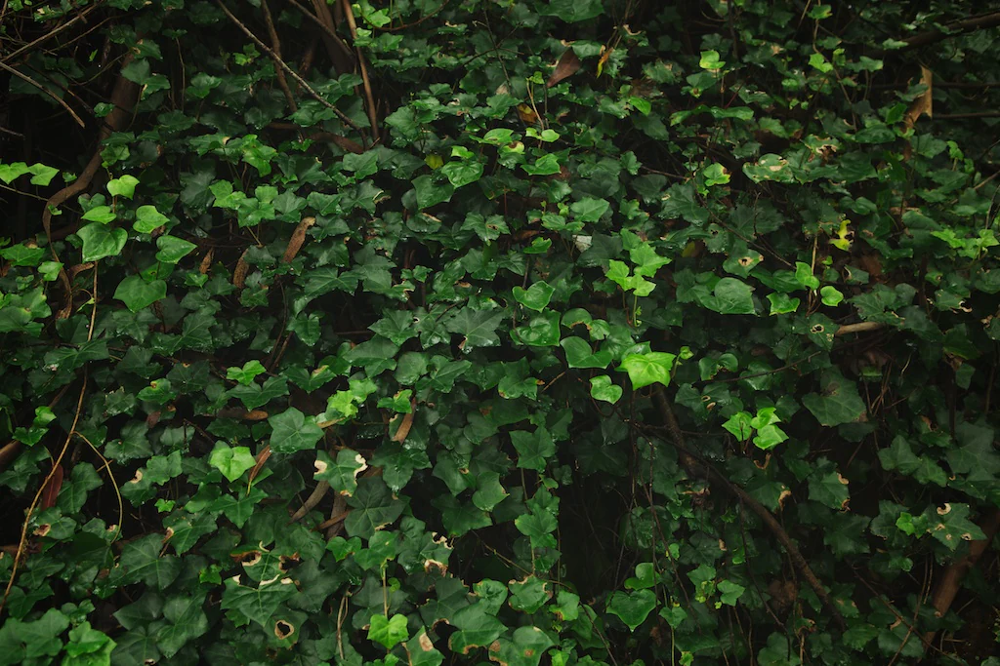

Think San Francisco is all bustling streets and cable cars? Think again! I recently discovered a new favorite spot in the city – Mount Davidson, a hidden gem offering a complete escape from the urban energy.

This isn't your typical city park. Mount Davidson boasts a dense tapestry of vegetation, transporting you to a world seemingly untouched by the metropolis. On foggy days, the atmosphere takes on an almost otherworldly feel, shrouded in an ethereal mist. It's a sensory experience that will leave you feeling refreshed and rejuvenated.

The hike itself is a rewarding adventure. As you ascend the trails, the cityscape gradually unfolds before you, offering breathtaking panoramic views. It's a powerful reminder of the natural beauty that coexists alongside the urban landscape.

Whether you're seeking a peaceful escape or a challenging hike with stunning vistas, Mount Davidson has something for everyone.  So lace up your boots and discover this hidden treasure in the heart of San Francisco!

<figure class="masonry">

</figure>