Just got back from an epic backpacking adventure in the Carson Iceberg Wilderness with my dad and a buddy! It was the perfect escape to reconnect with nature and experience the beauty of the Sierra Nevada. Most of these images were captured on Kodak Ektar film, capturing the vibrant colors of the landscape in a truly unique way.

We stumbled upon this incredible hidden meadow – picture a lush green oasis with a crystal-clear pond, surrounded by towering pines. Nestled amongst the trees were these old, rustic cabins, adding to the charm and a touch of mystery. And to top it all off, a herd of gentle cattle with clanging bells grazed nearby, creating a truly idyllic scene. It felt like we were transported straight to the Swiss Alps!

This trip was all about spending quality time with dad and pushing our limits a bit on the trails. We hiked through breathtaking landscapes, camped under a blanket of stars, and shared stories by the crackling campfire. It was an unforgettable experience that strengthened our bond and left us with incredible memories.

<figure class="masonry">
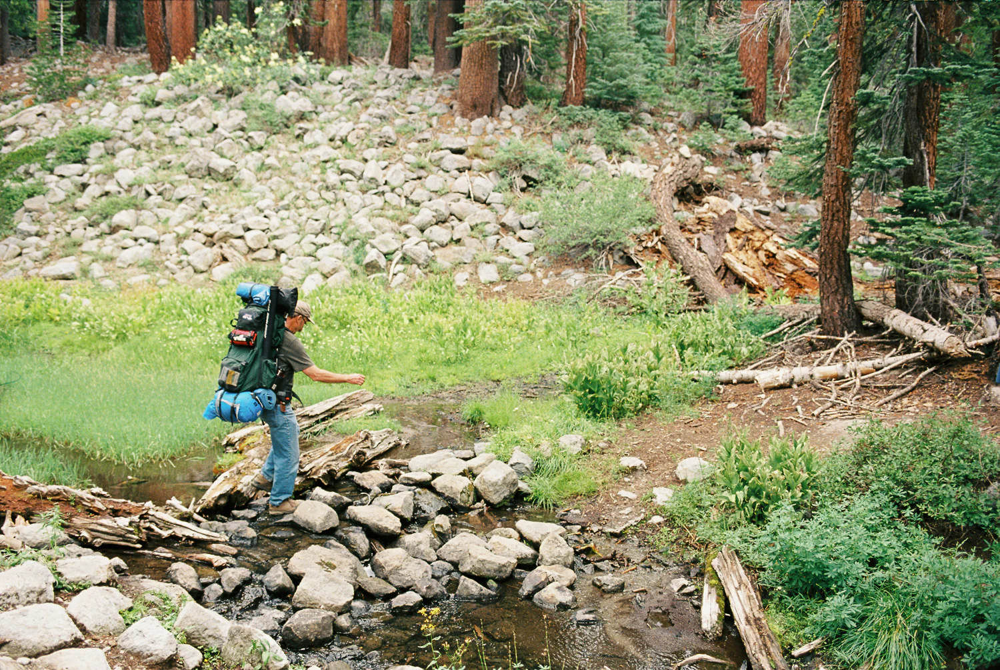
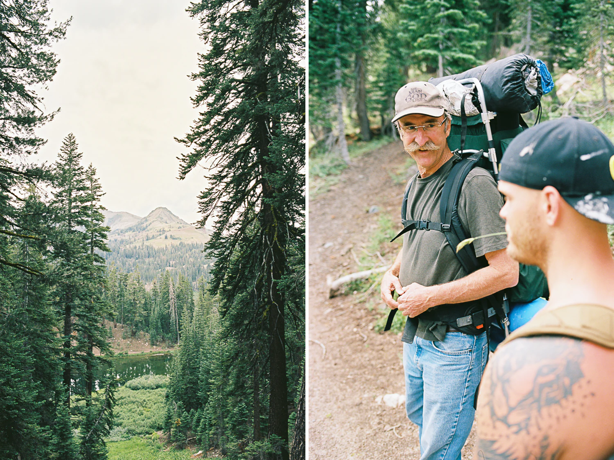
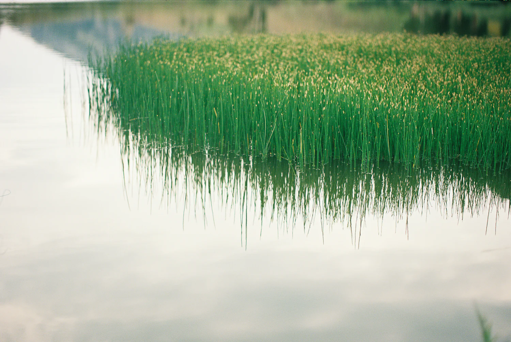
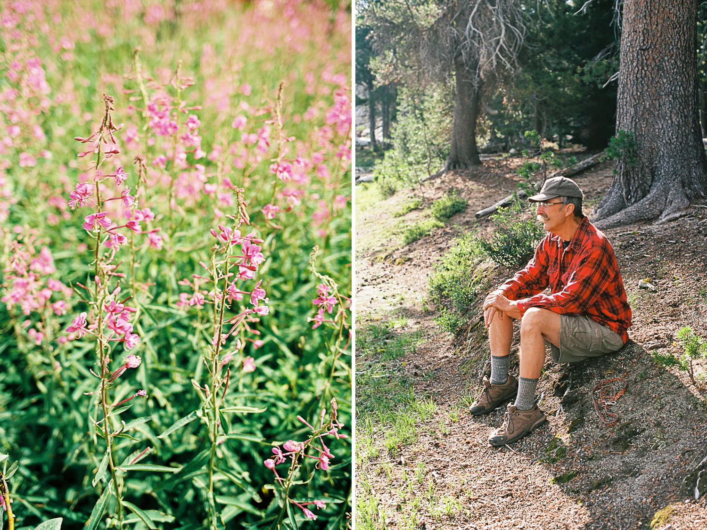
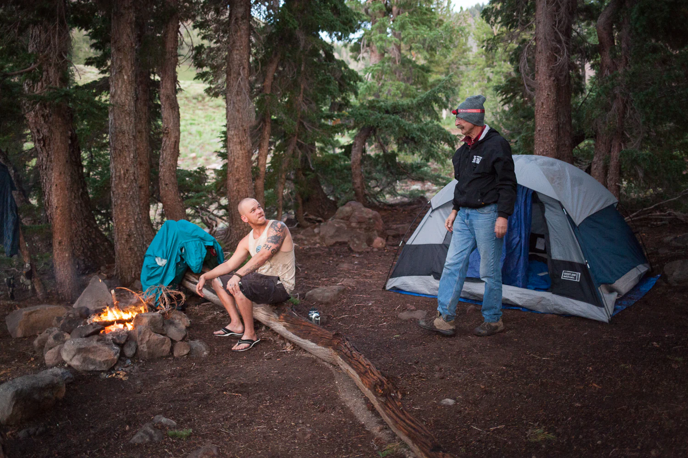
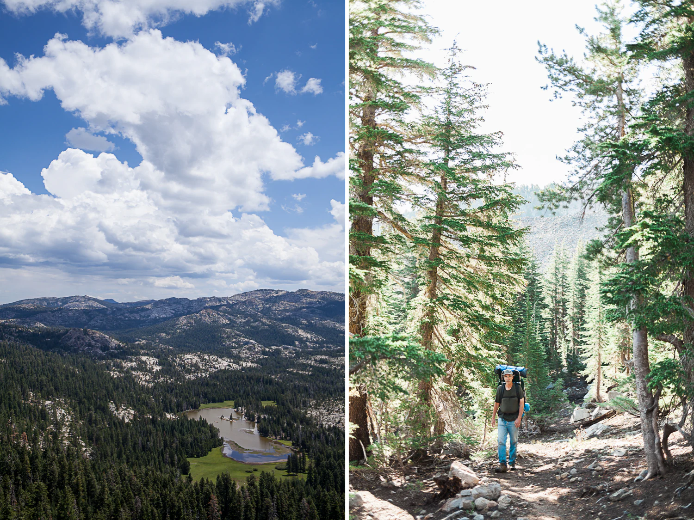
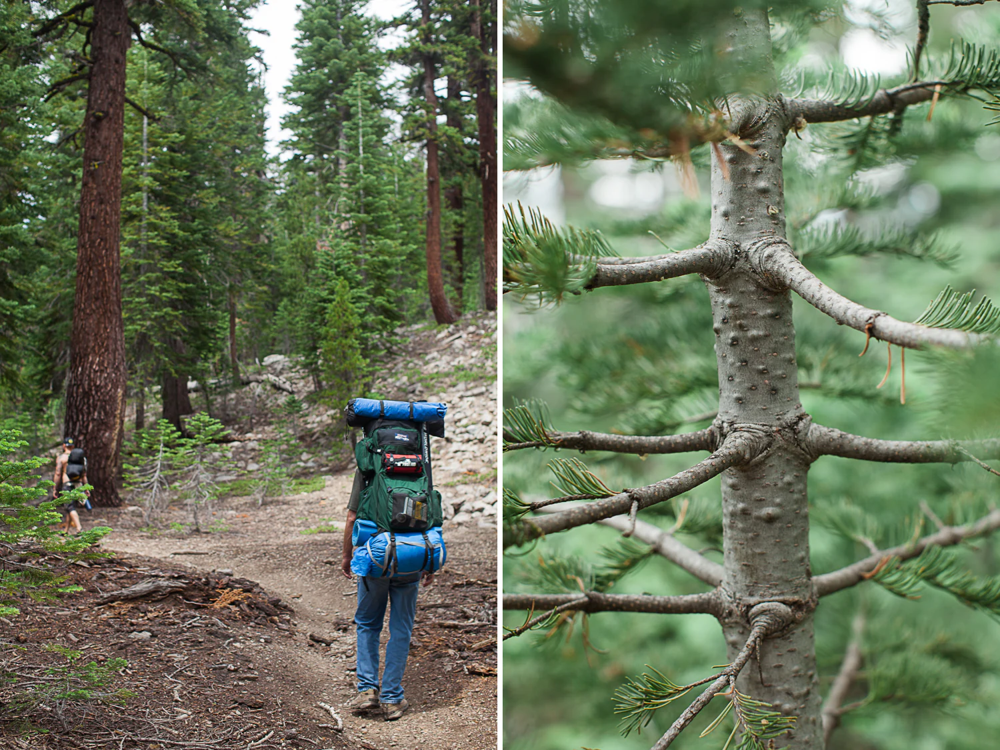
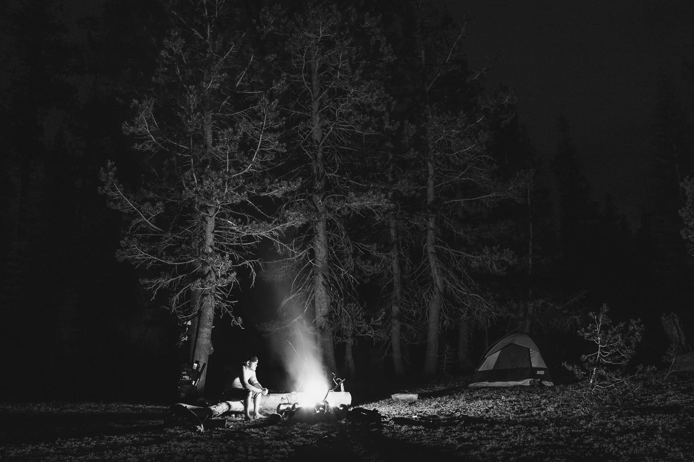
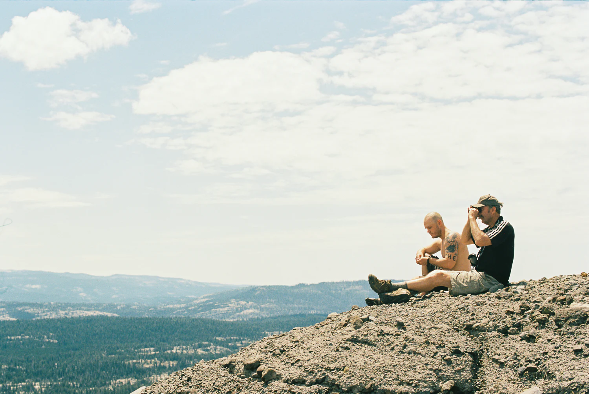
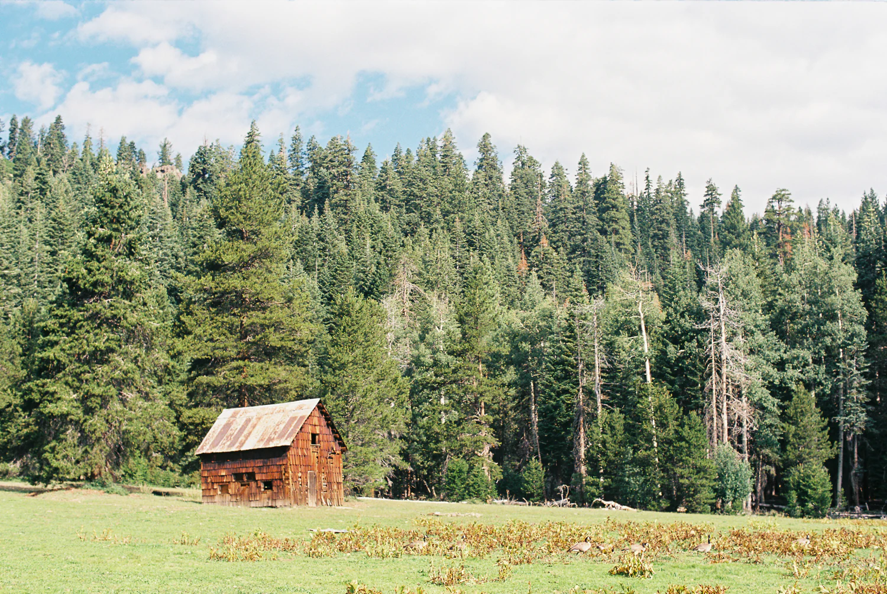
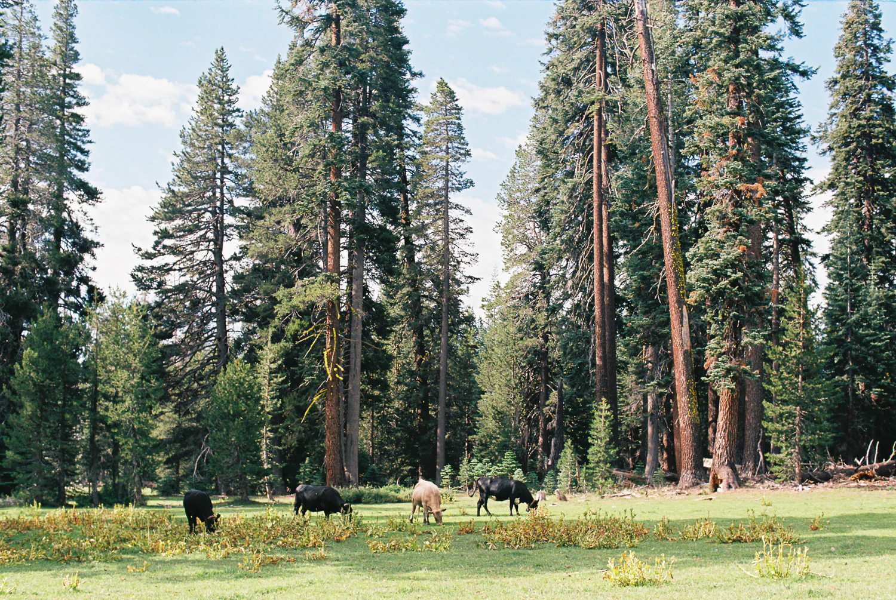

</figure>