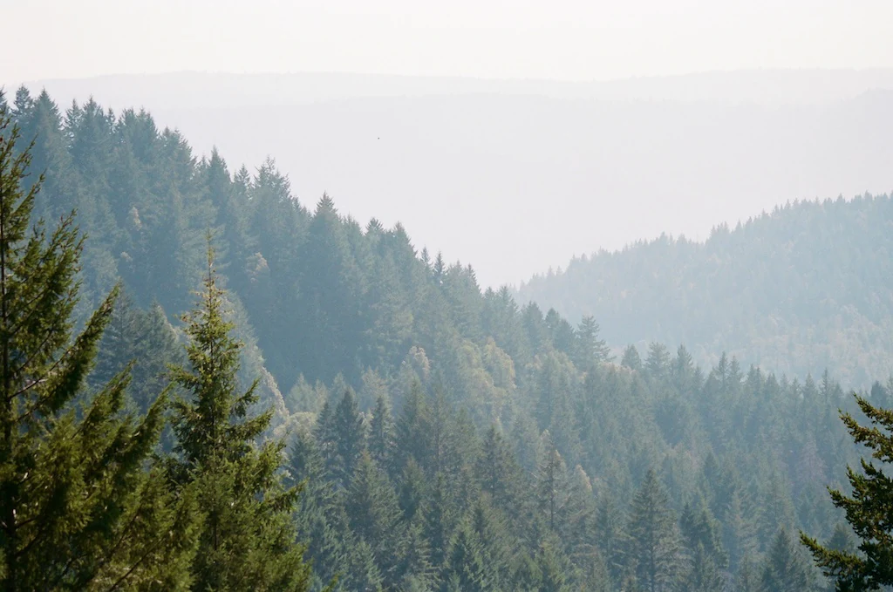
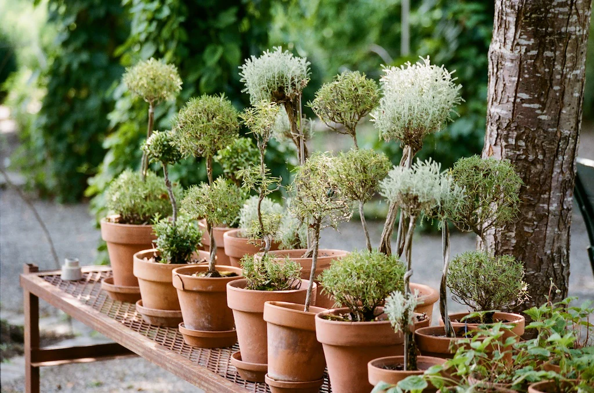
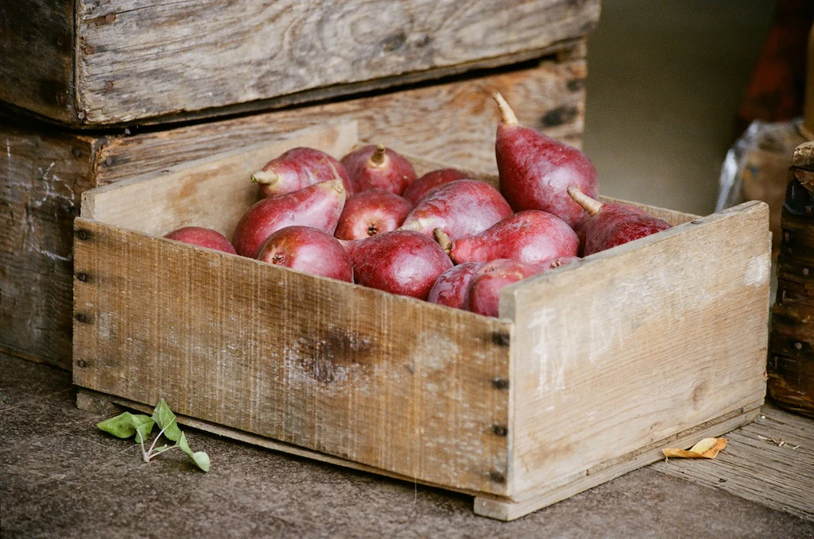
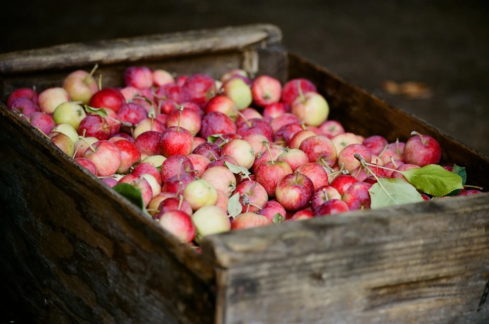
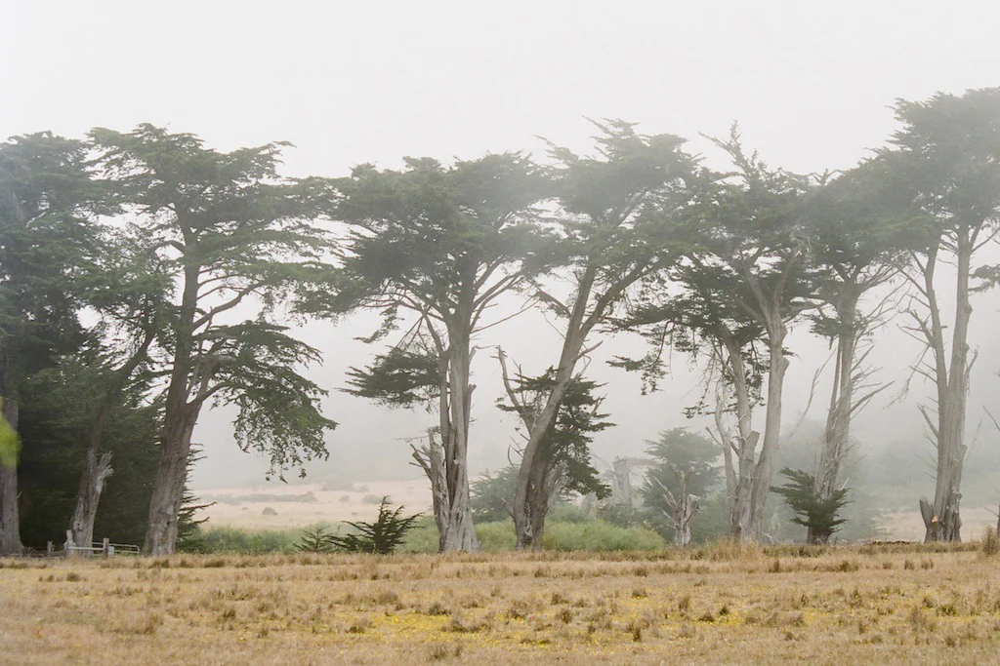
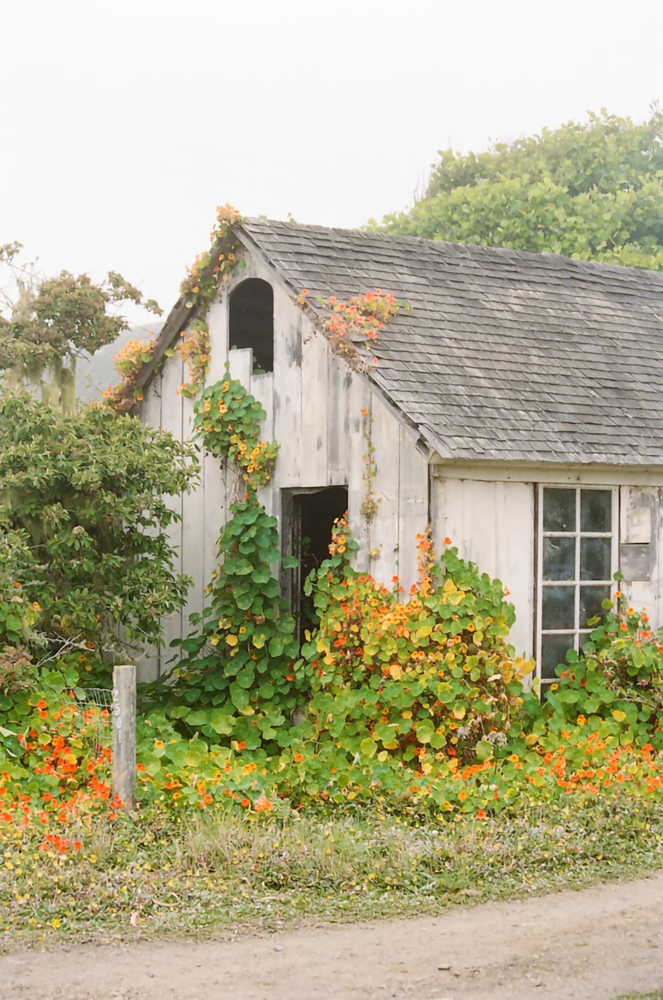
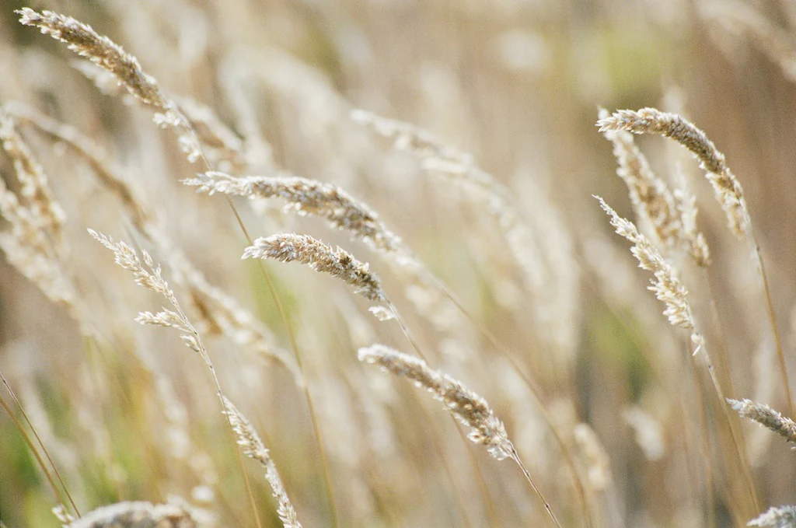
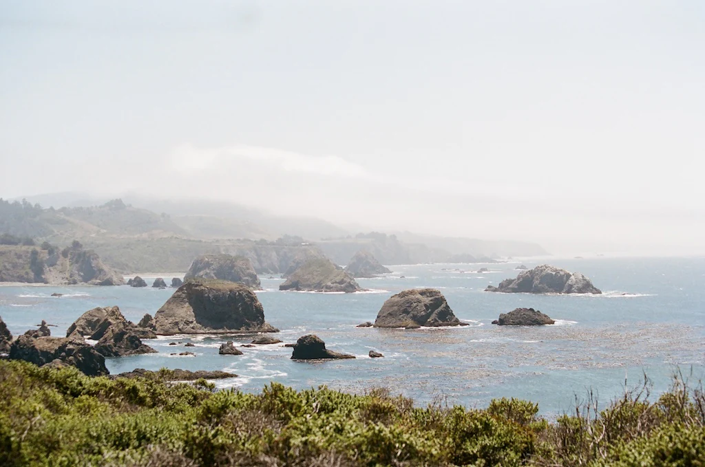
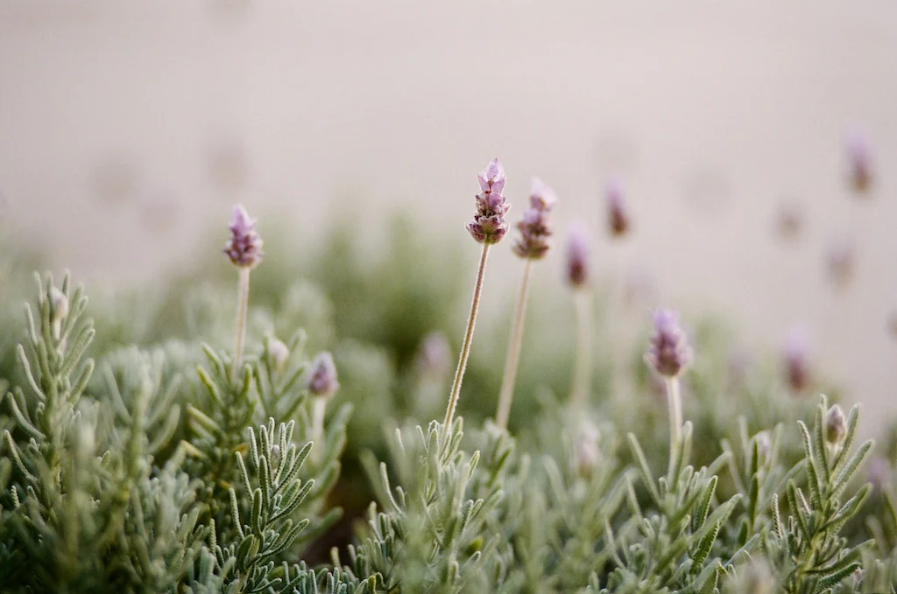

I’m pretty excited to share these photos with you! As you may know, I’ve been playing around with film recently and just got some images back from the developer (for those film folks out there, this was Portra 400 and developed at [Richard Photo Lab](https://www.richardphotolab.com){:target="_blank" rel="noopener noreferrer"}).

For this road trip, I headed up the scenic California coast into Mendocino County. Along the way, I stopped to visit some truly inspiring locations, including the Philo Apple Farm and Anderson Valley Brewing Company.

The [Philo Apple Farm](https://www.philoapplefarm.com/weddings){:target="_blank" rel="noopener noreferrer"} is a photographer's dream! It has a rustic, old-world charm that would be perfect for a unique California wedding or an intimate Mendocino elopement. The farm stand, orchards, and gardens offer endless possibilities for beautiful wedding photos. Imagine couples portraits amidst the blooming apple trees or a romantic reception under the stars.

Overall, it was a fantastic trip, and I can't wait to explore more stunning California wedding locations.

<figure class="masonry">

</figure>