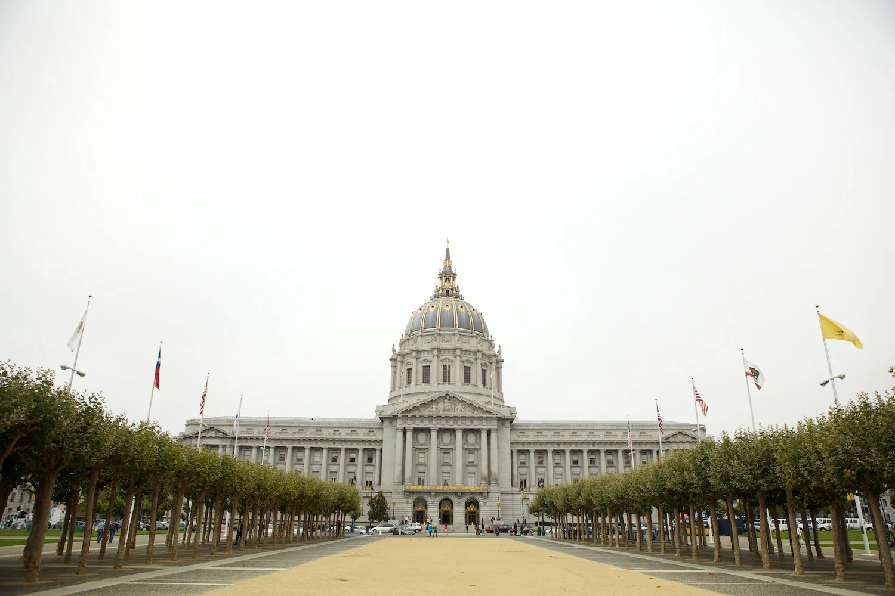
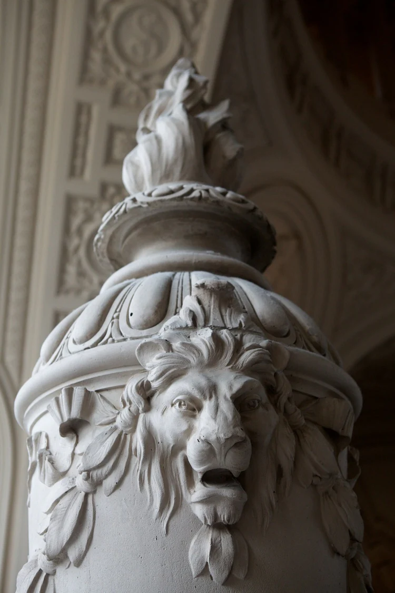
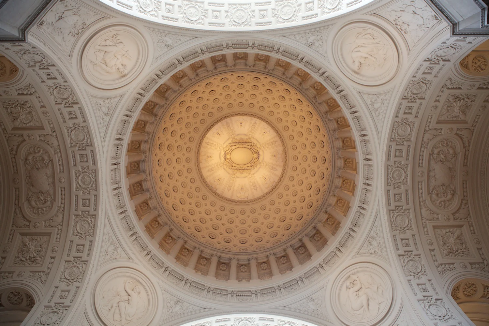
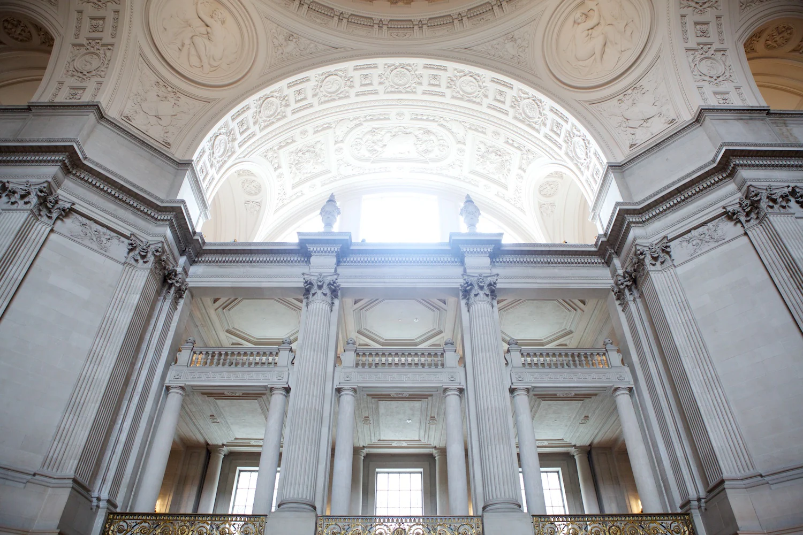
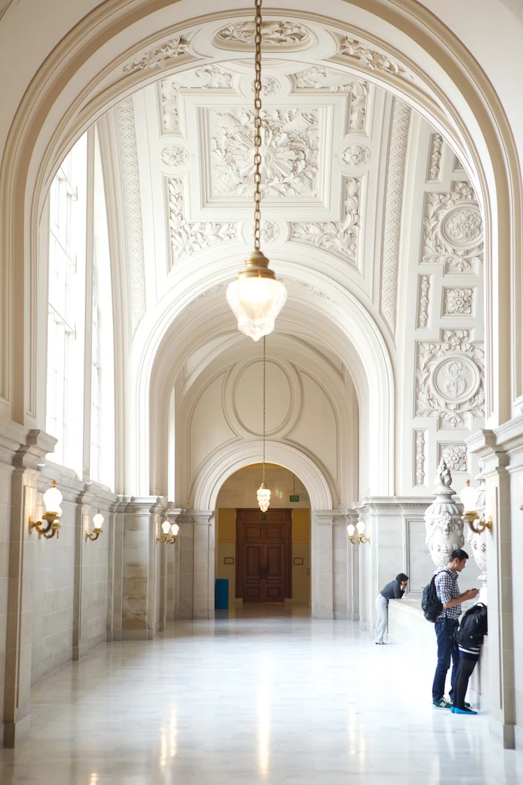
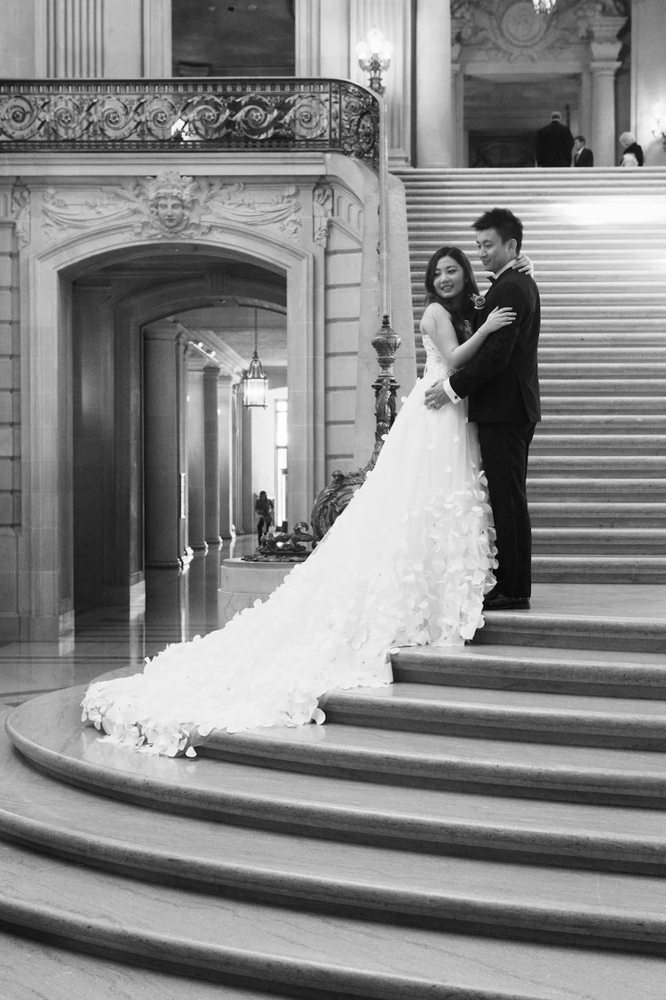
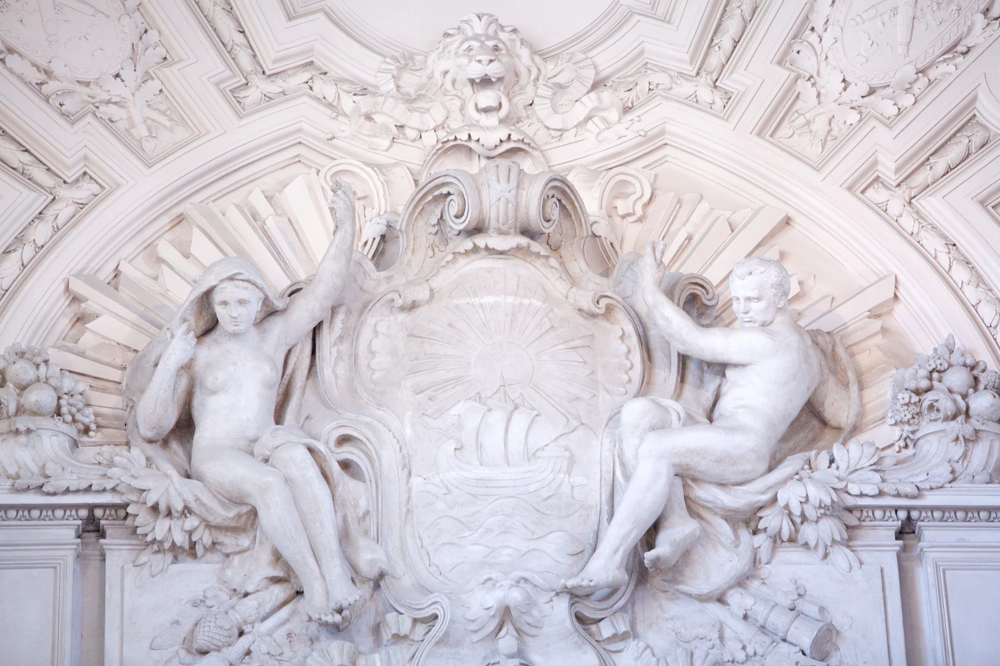

Dreaming of an intimate and unforgettable elopement? Look no further than San Francisco City Hall. This iconic landmark boasts breathtaking architecture, with intricate details that create a truly magical atmosphere. From the ornate ceilings to the elegant marble floors, every corner offers a stunning backdrop for your elopement photos.

As a professional photographer with extensive portrait experience, I'm drawn to the unique beauty and grandeur of City Hall. The intimate setting, combined with the building's architectural splendor, provides an ideal canvas for capturing timeless and romantic images.

If you're considering an elopement in San Francisco, City Hall is an absolute must-see. Let's create stunning photographs that will cherish forever.

<figure class="masonry">

</figure>