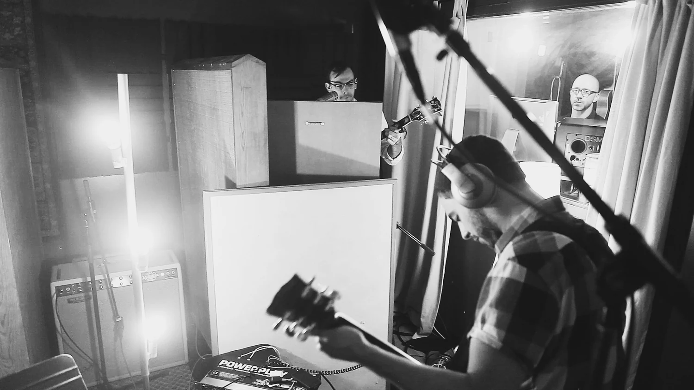
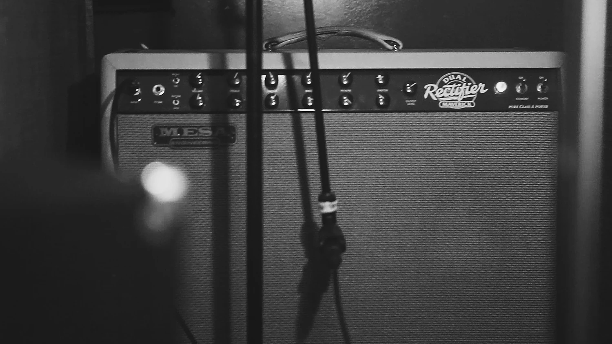
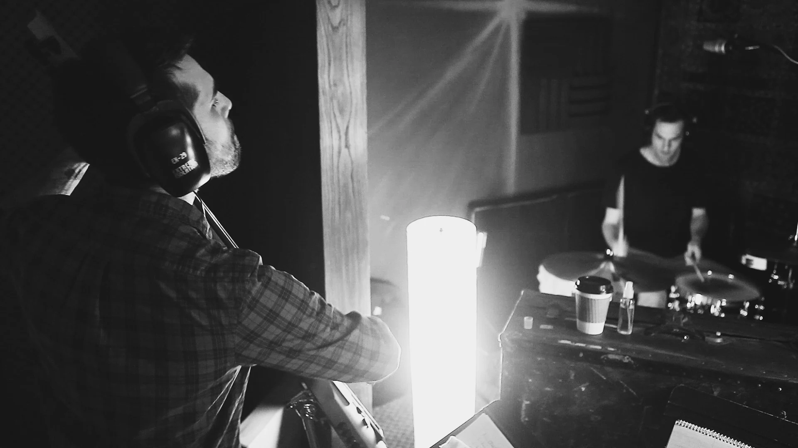
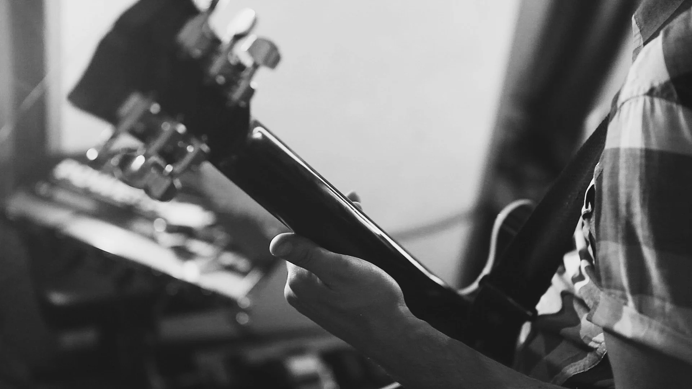
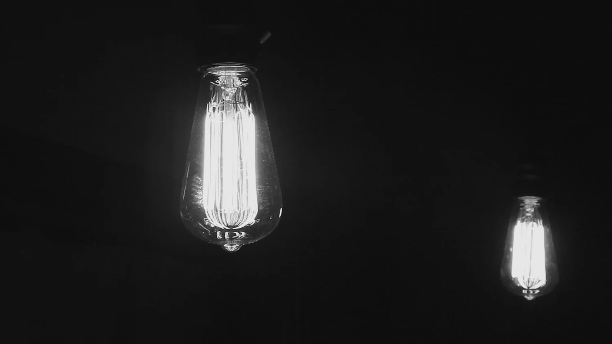
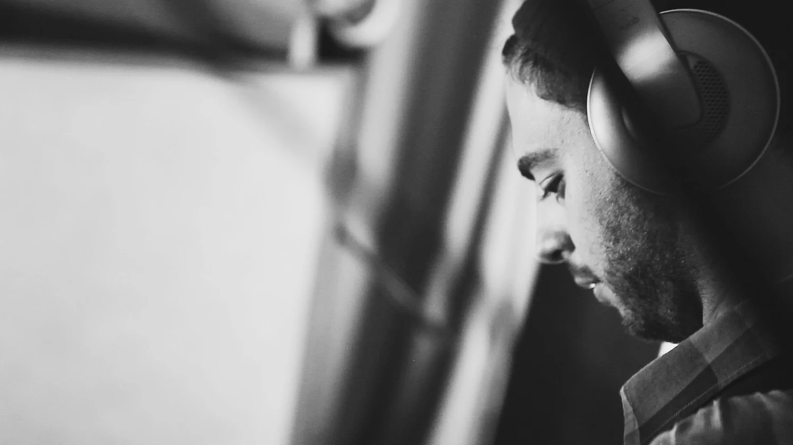
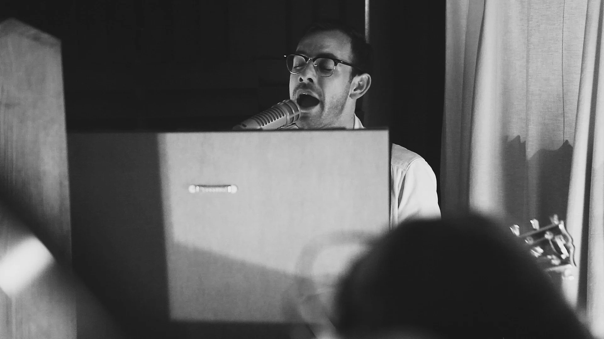
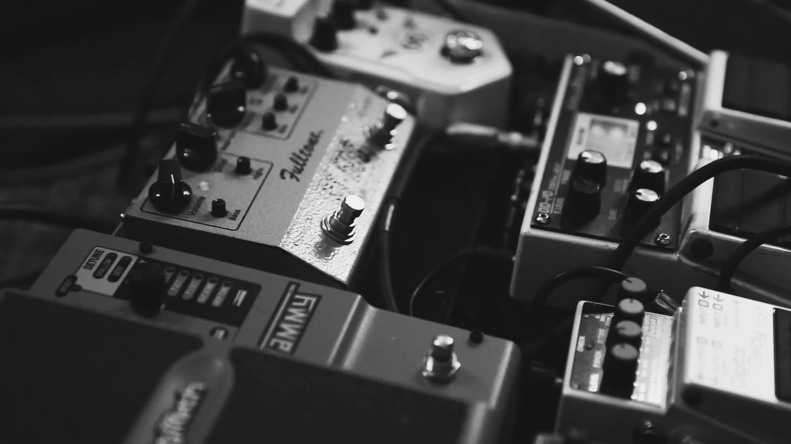

<iframe src="https://player.vimeo.com/video/97156865?h=21bf802066" frameborder="0" allow="autoplay; fullscreen; picture-in-picture" allowfullscreen></iframe>

I had the emmense privilege of helping my friend Char Brodersen with his recent record project. For this project, we went down to Coasta Mesa to record a few songs for a hymn album that he has been wanting to make for a while. This video is a glimpse into the making of one of those hymns. The aim of this project was to take a few ancient hymns and reinterpret them in an engaging and dynamic manner. A special thanks to Neil Godding for producing this album. Enjoy the following stills and watch the video already!

<figure class="masonry">

</figure>

PS 

Check out the project on 
[Spotify here](https://open.spotify.com/album/7169tlQRBTYyC1g75XD2aN?si=L5KWOTi0Ty-sOgvA584x3g).
