Last year I went on a crazy trip to Utah but somehow never posted any photos! I figured it was better late then never so here we go. Get ready for images from Arches, Canyonlands, Antelope Canyon , Bryce Canyon and the Grand Canyon. If you haven't visited these parks, you have to do it!

<figure class="masonry">
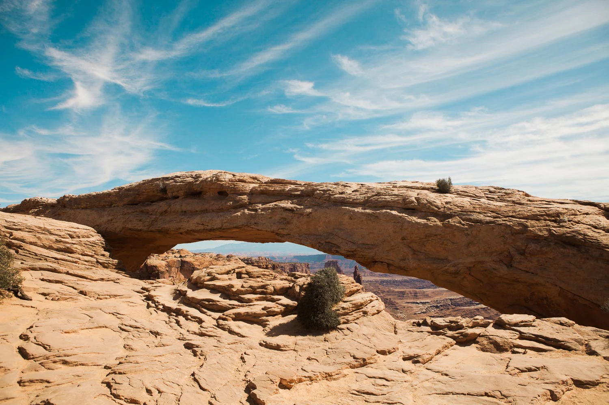
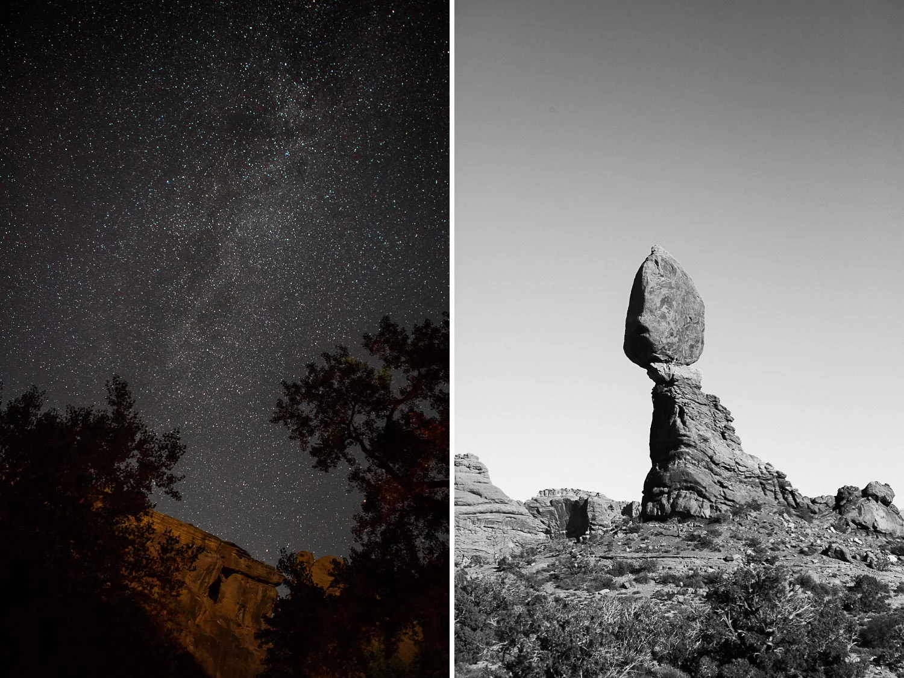
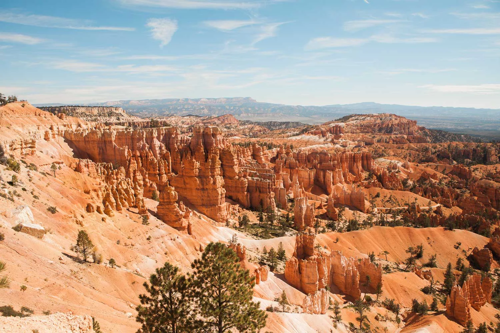
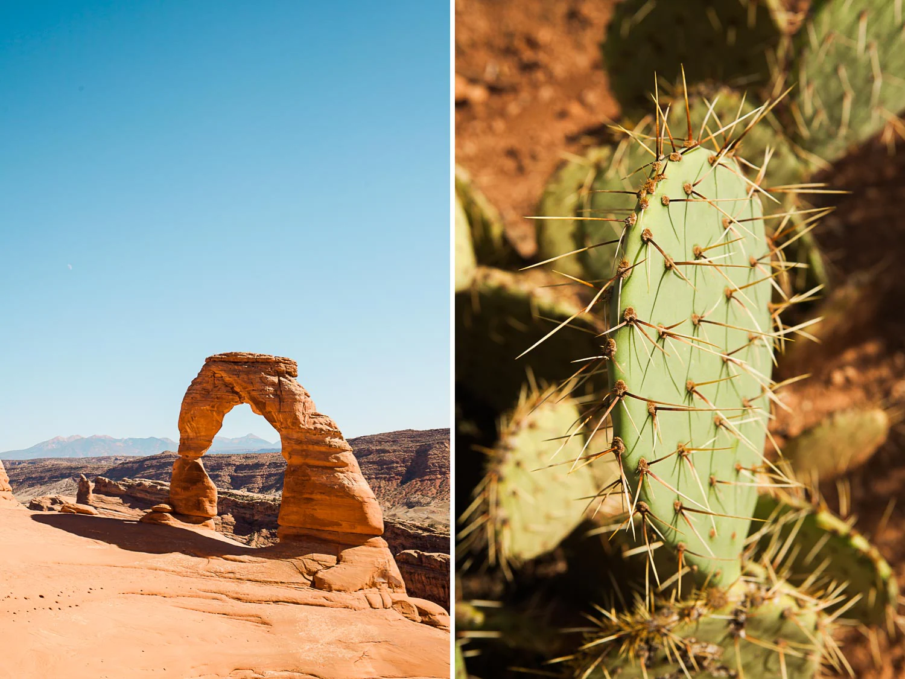
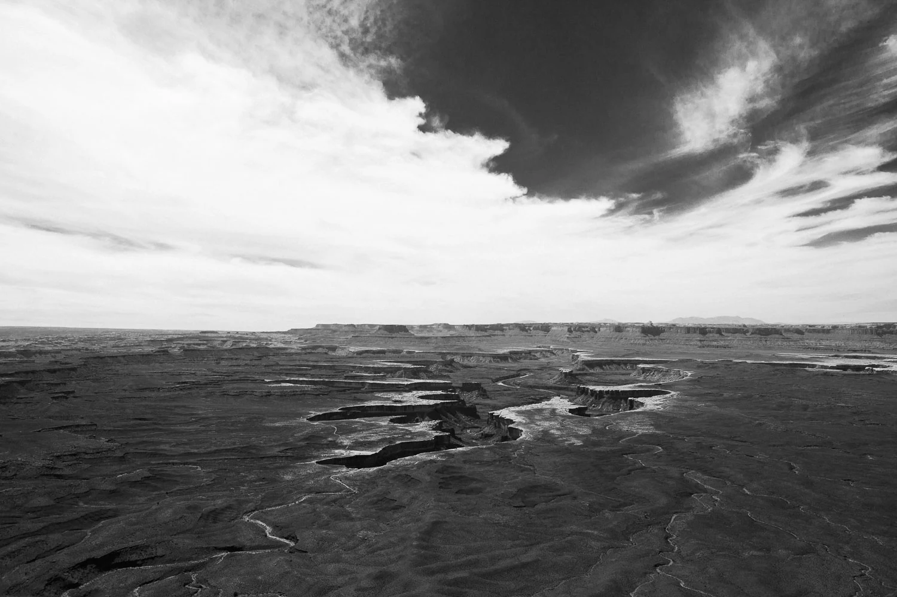
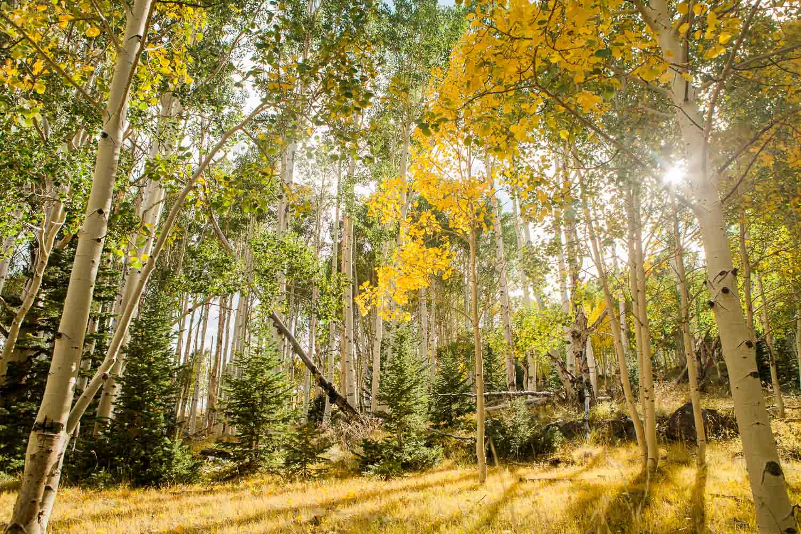
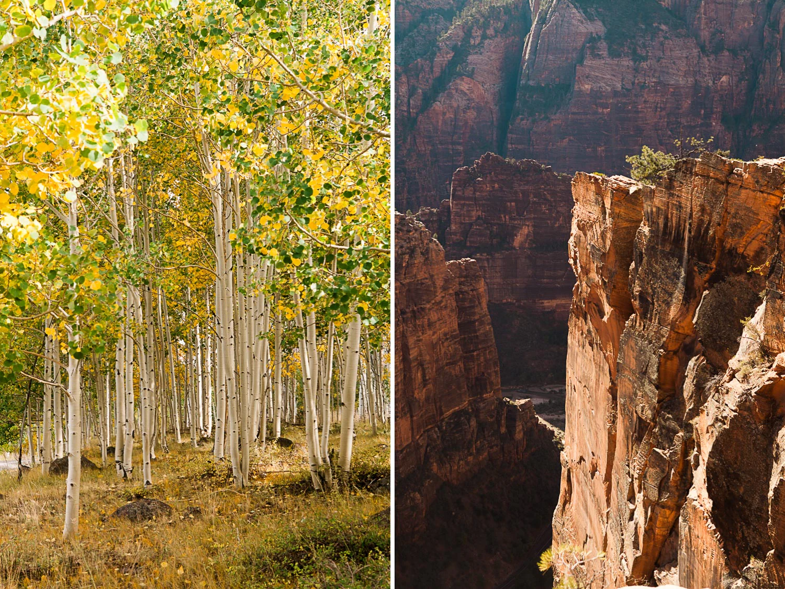
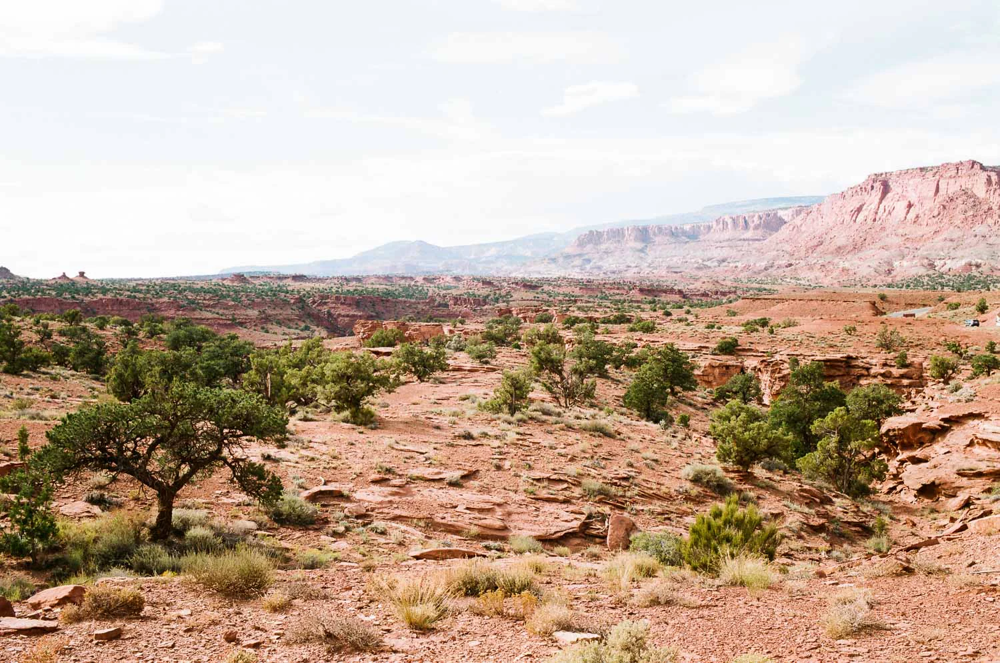
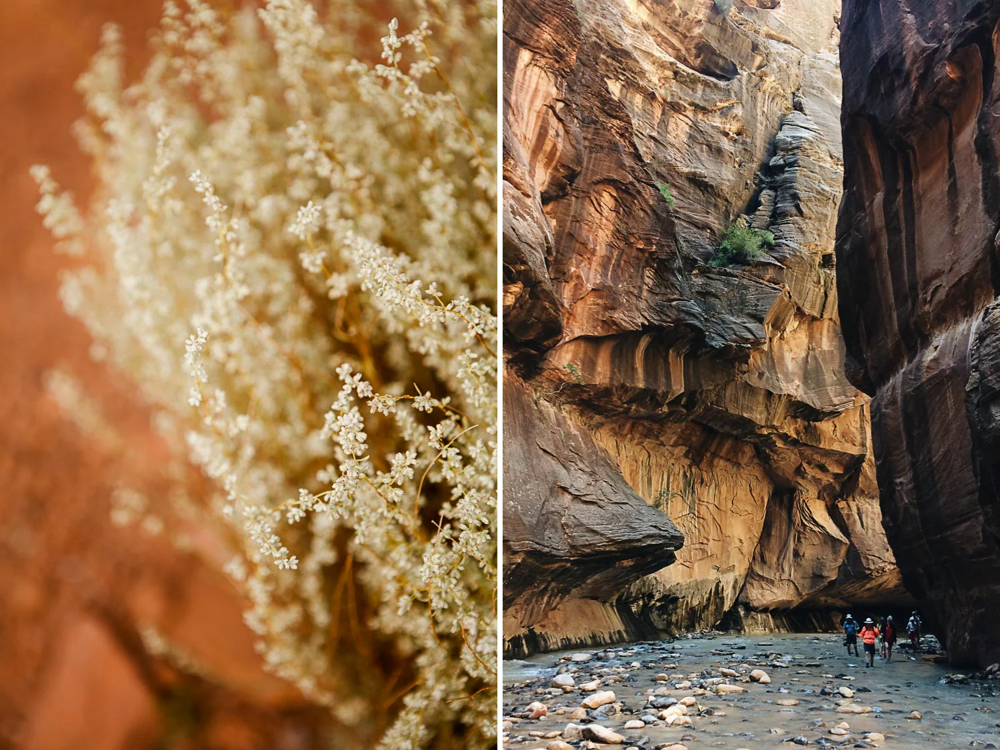
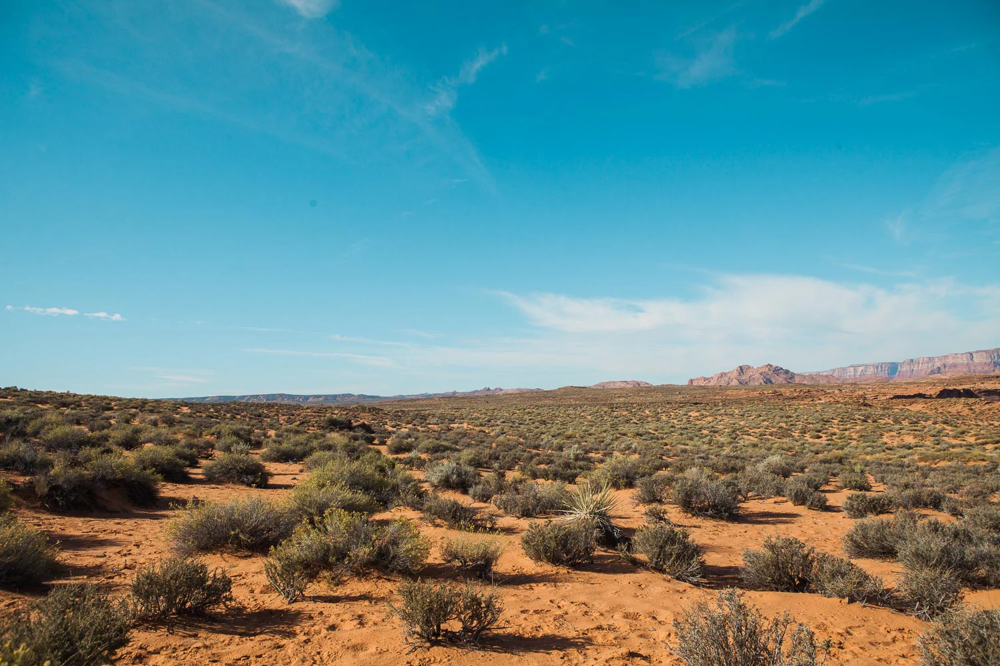
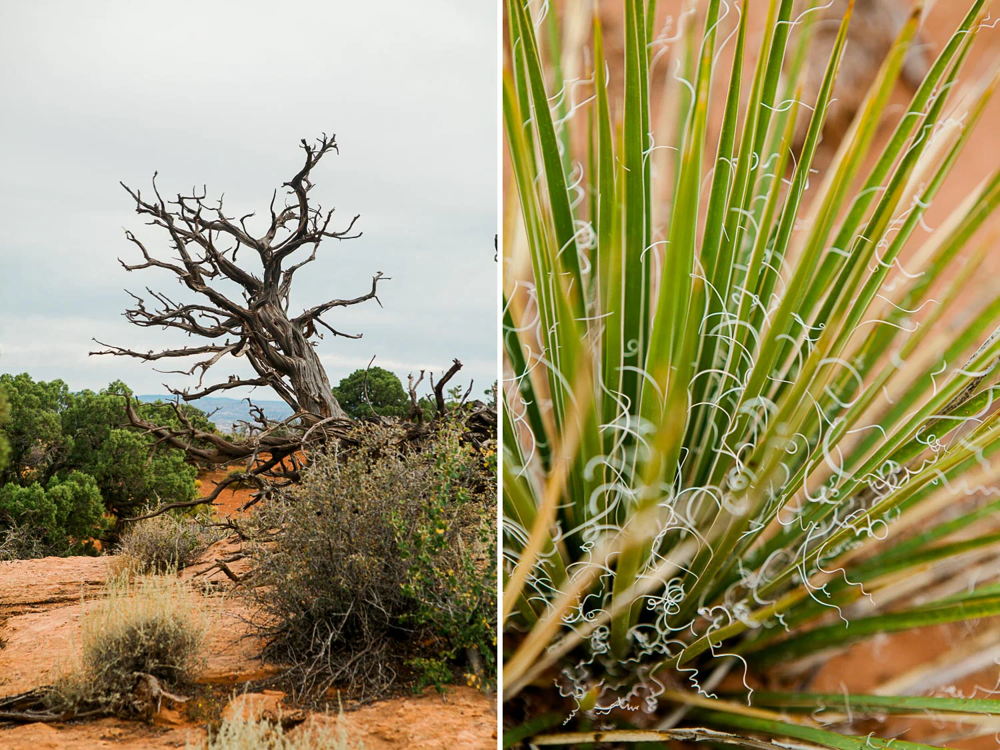
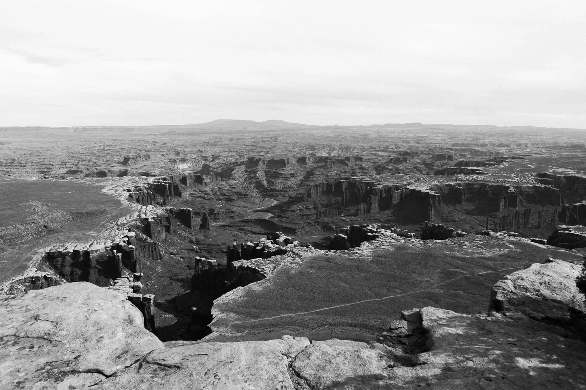
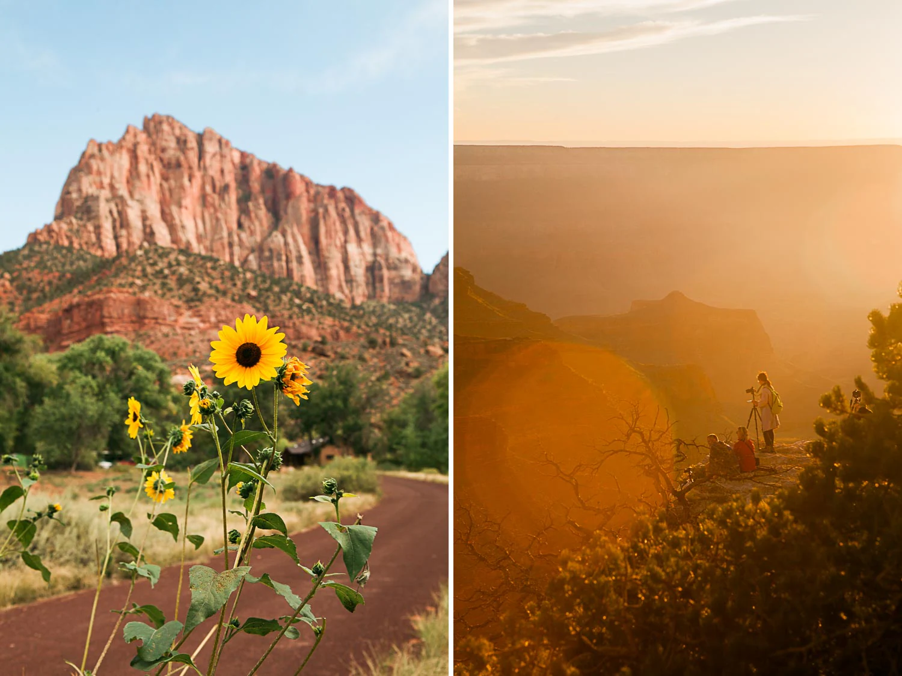
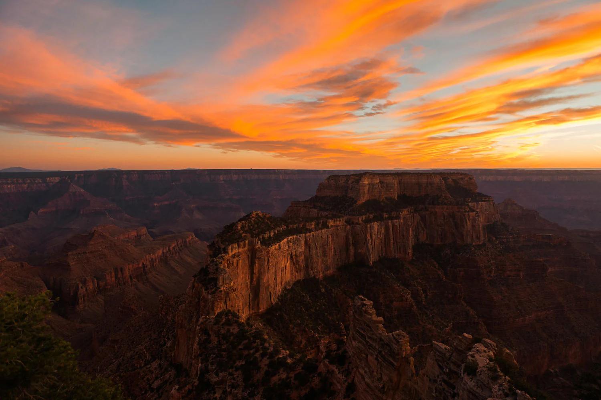
</figure>