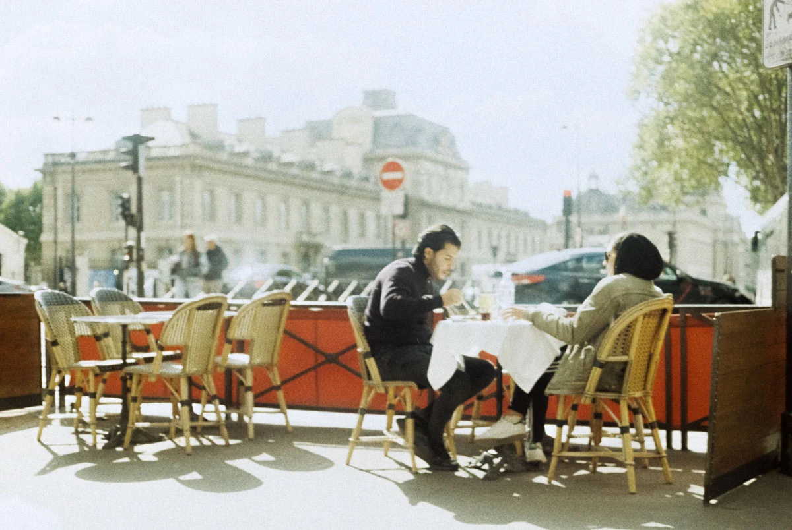
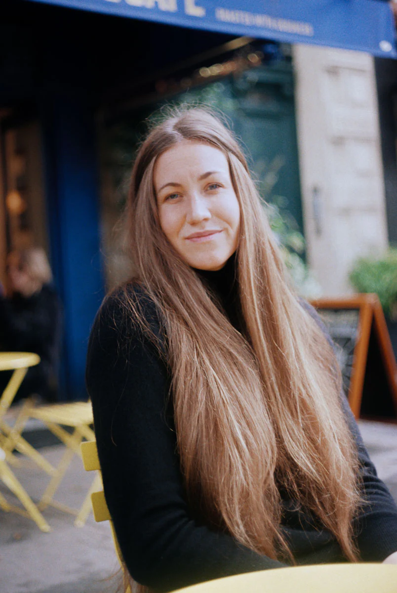
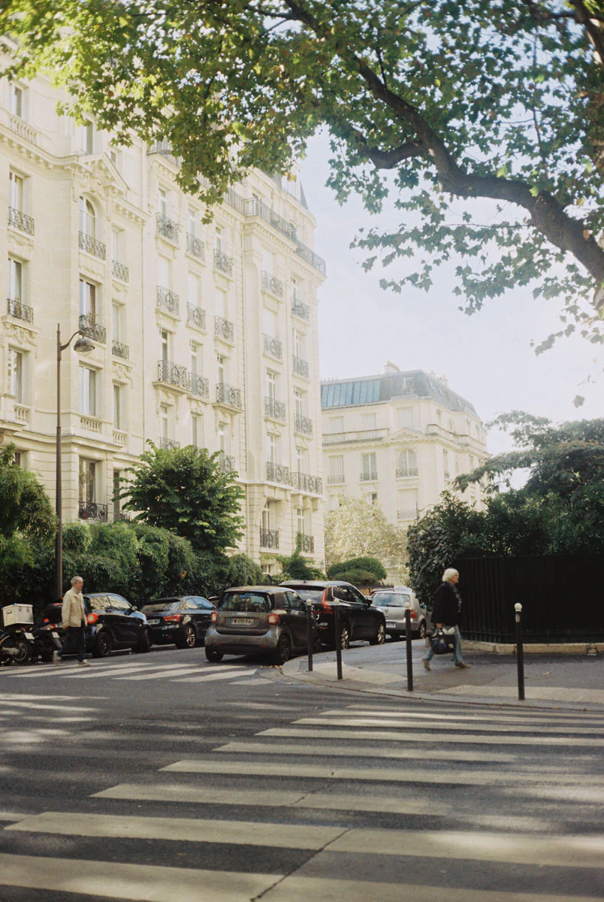
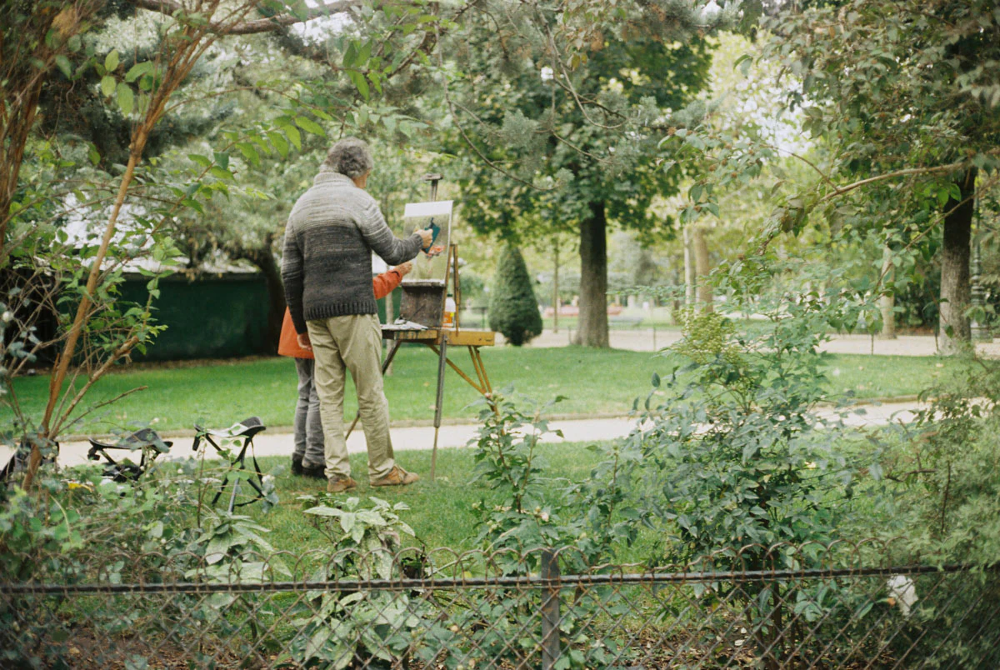
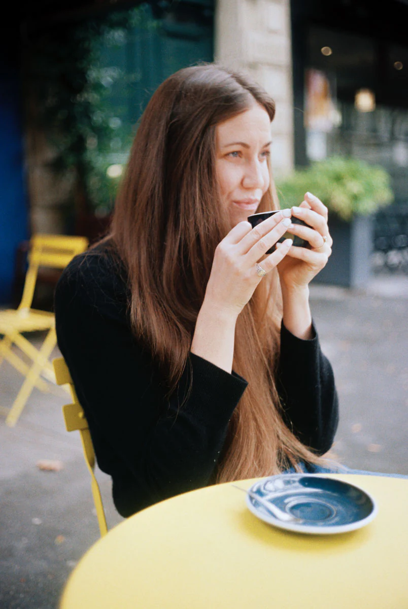
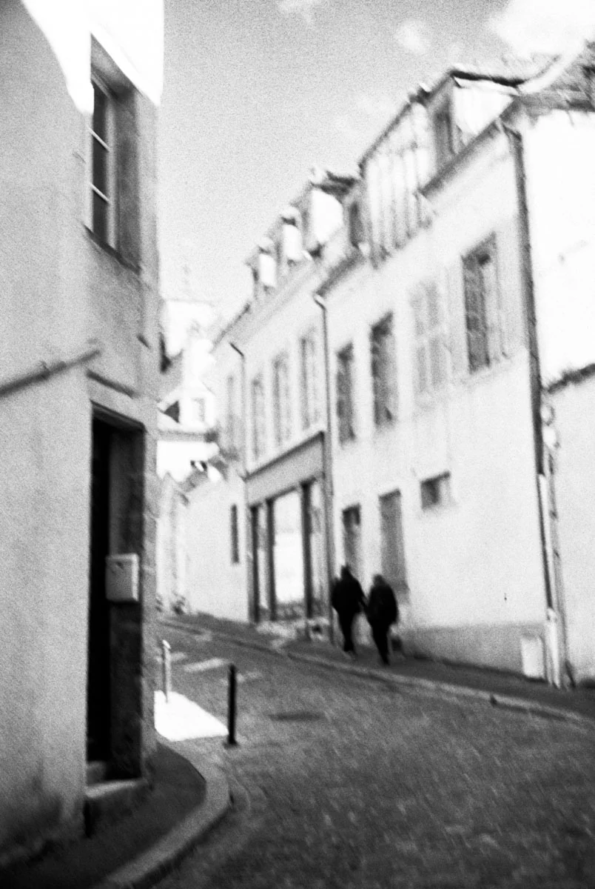
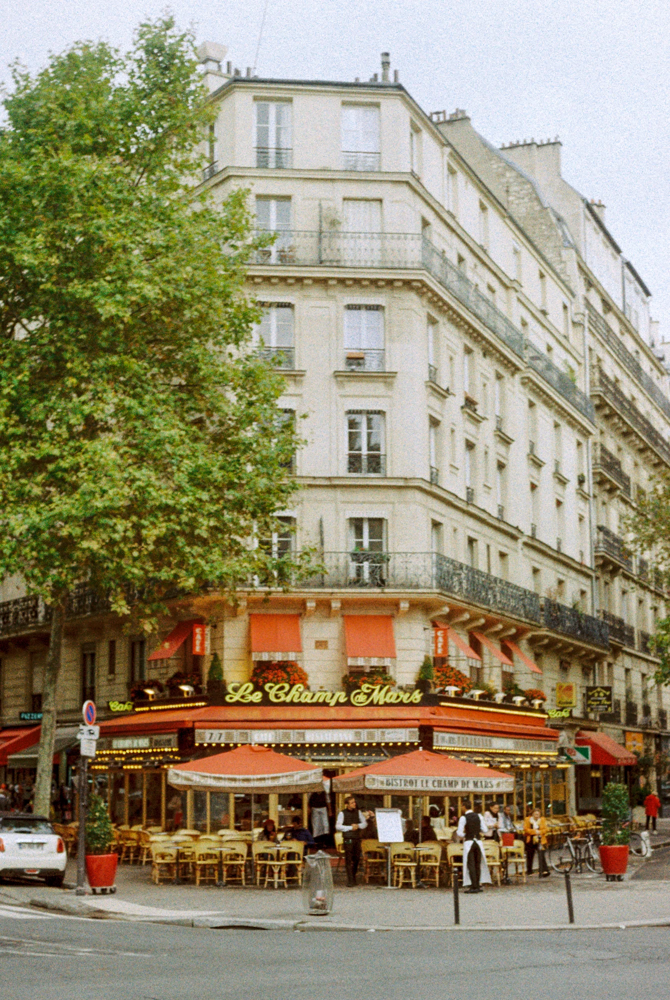
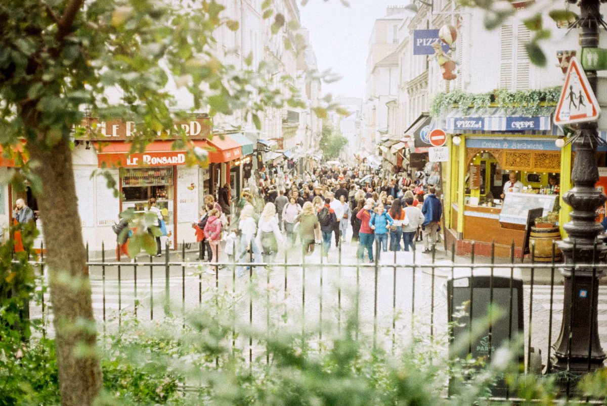
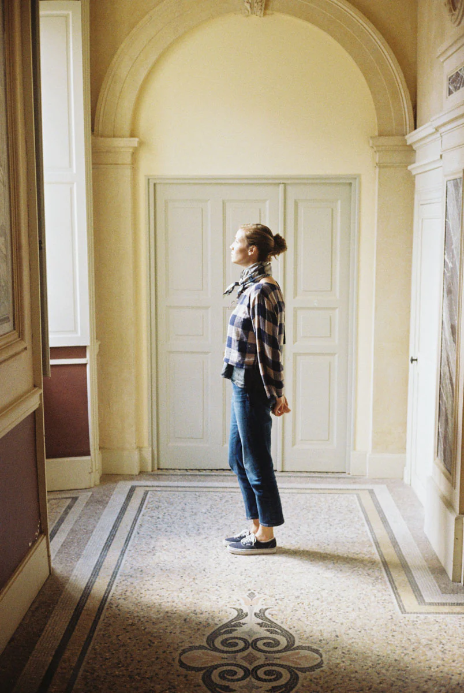
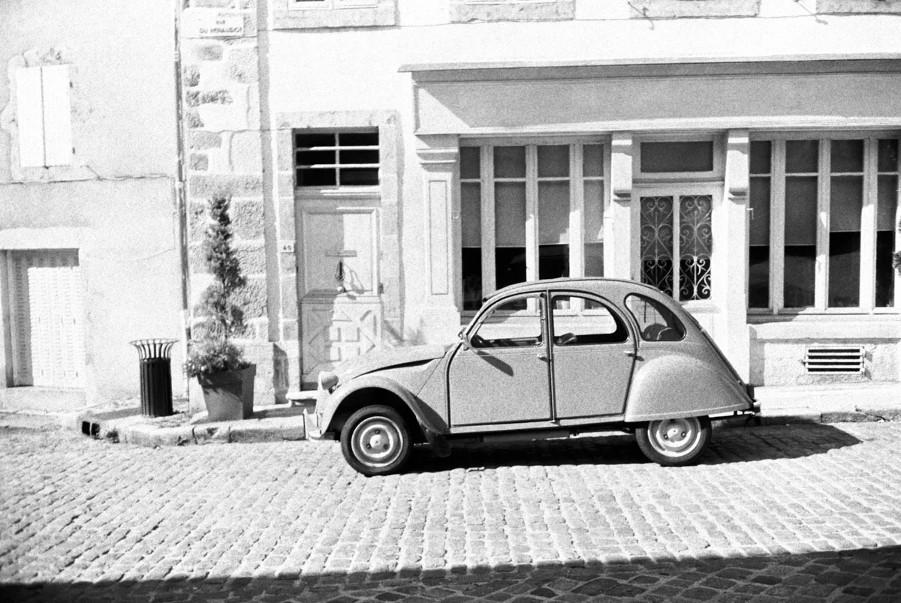

In the early fall of 2022, we embarked on a trip that began in the charming Burgundy and concluded in the vibrant city of Paris. I documented our journey using Kodak Color Plus film and my Olympus 35 SP Rangefinder.

Semur-en-Auxois, with its medieval ramparts and peaceful atmosphere, offered a delightful starting point for our journey. We then made our way north, eventually arriving in Paris, where we enjoyed classic sights like the Eiffel Tower and spent time exploring hidden corners of the city.

It was a memorable trip, filled with both the tranquility of the French countryside and the excitement of city life.

<figure class="masonry">

</figure>
