The rain fell softly as we embarked on our hike to Sonoma Creek Falls. The forest, lush and vibrant, seemed to hum with a quiet energy. My wife, inspired by the glistening California Bay Laurels, wove whimsical crowns, adding a touch of magic to our adventure.

We followed the gurgling creek upstream, the sound of the water a constant lullaby. The falls themselves were a breathtaking sight, a cascade of water tumbling down a moss-covered rock face.

The rain may have dampened the trail, but it certainly didn't dampen our spirits. We emerged from the forest feeling refreshed and invigorated, reminded that even on a less-than-perfect day, nature can offer moments of profound beauty.

<figure class="masonry">
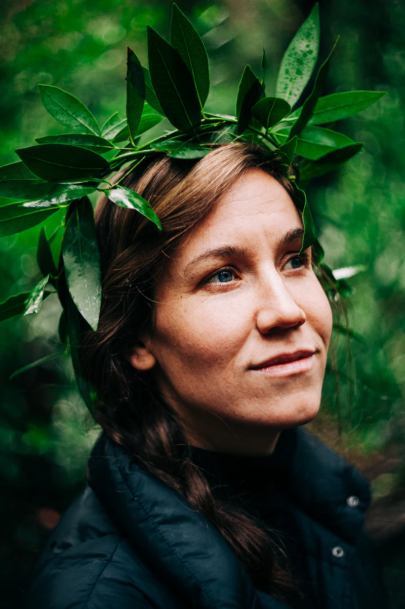
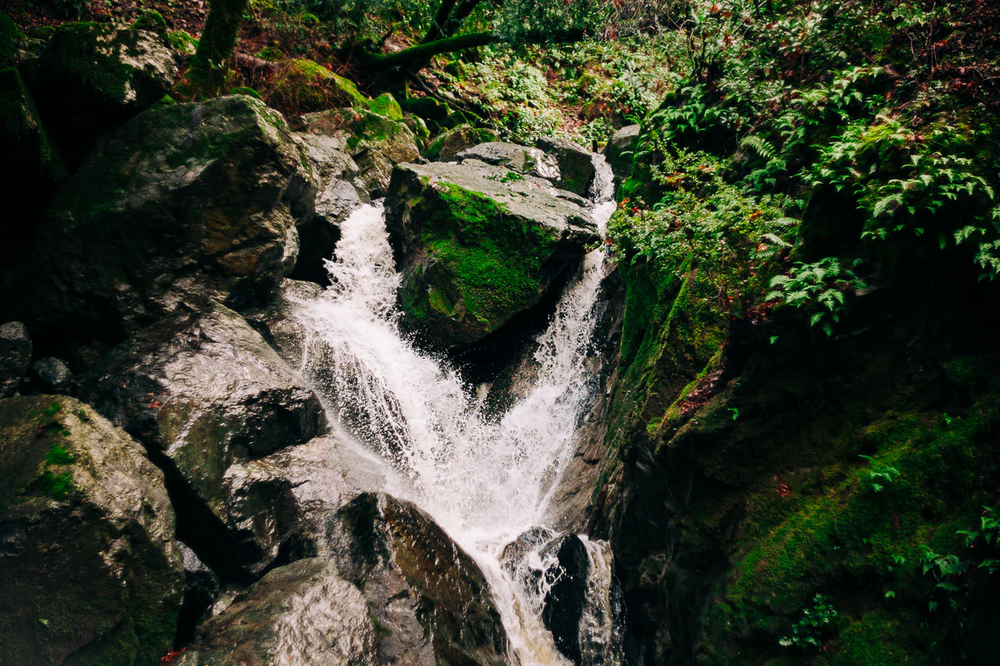

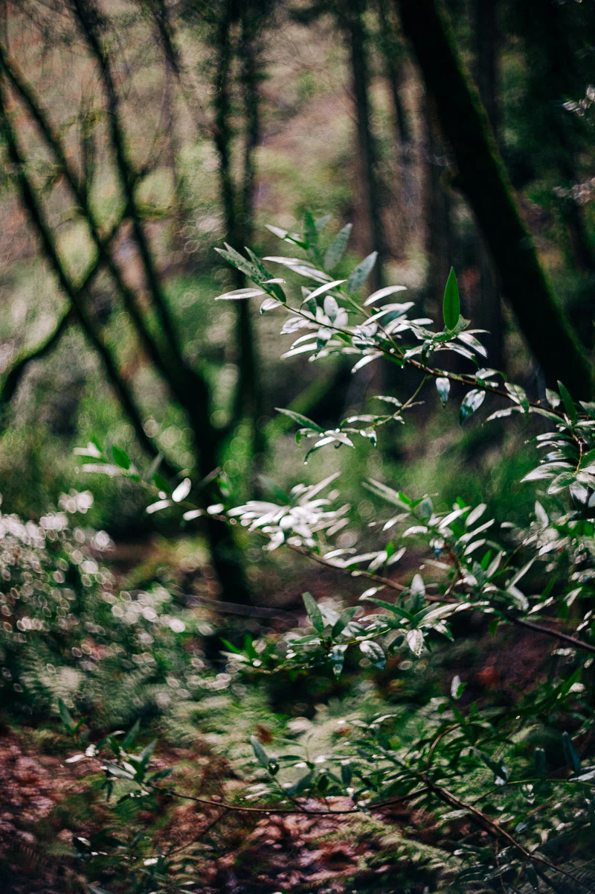
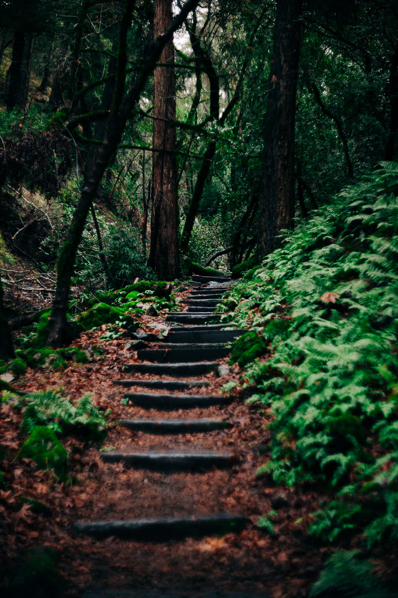
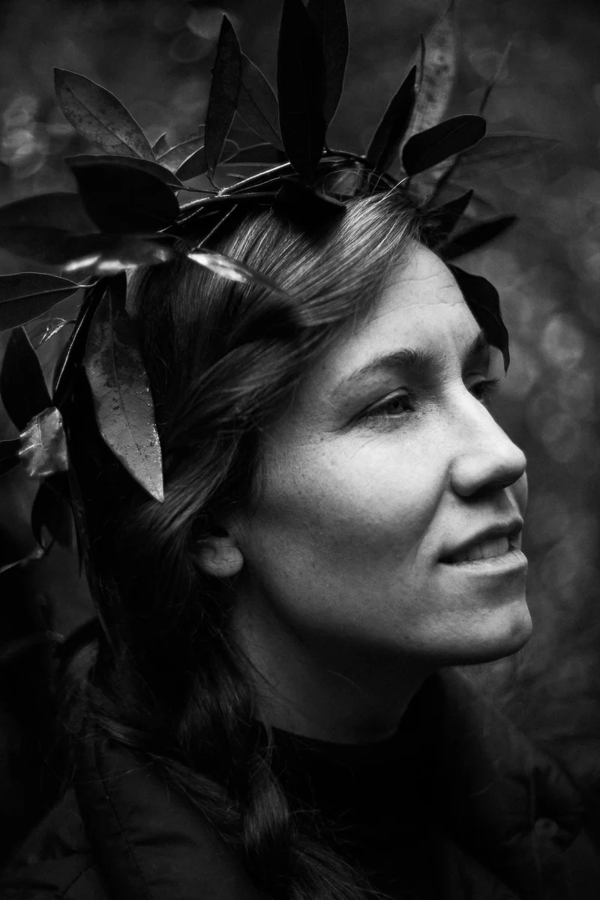

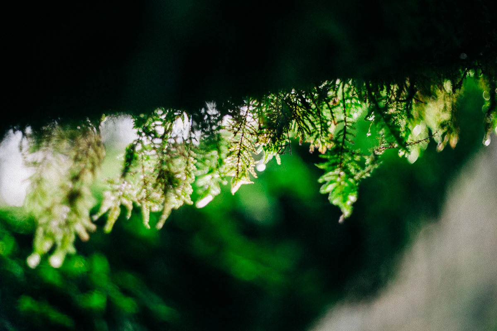

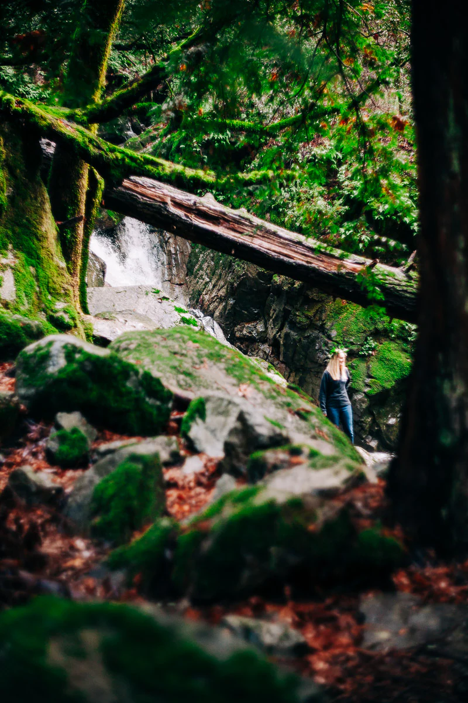
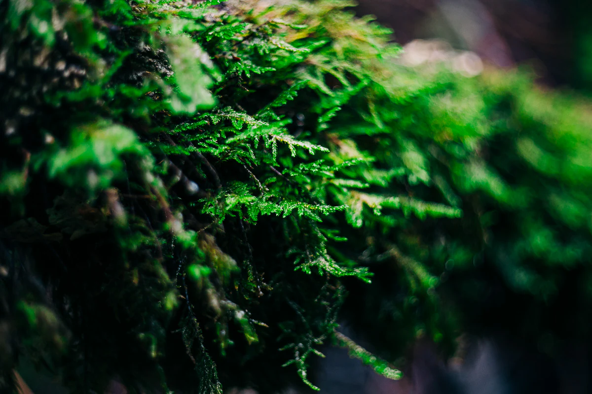

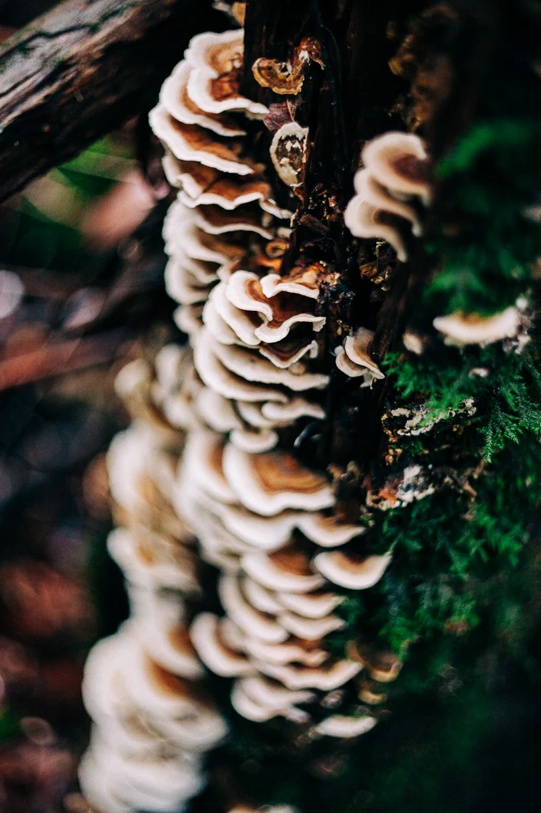
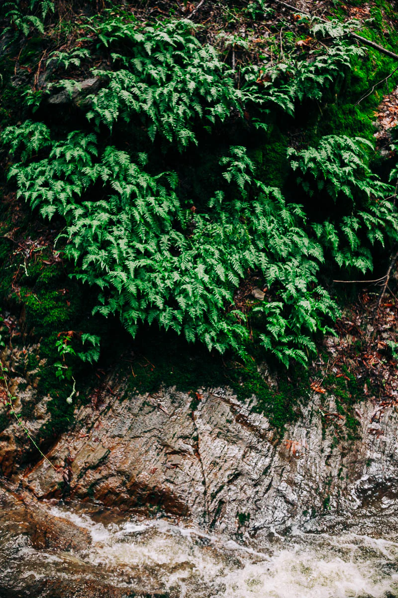

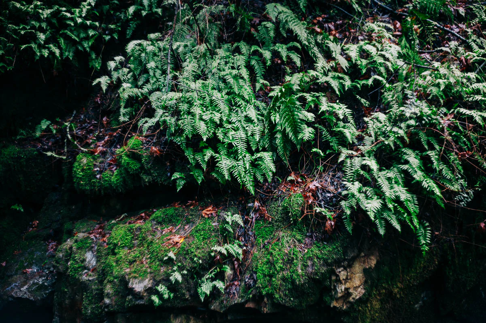

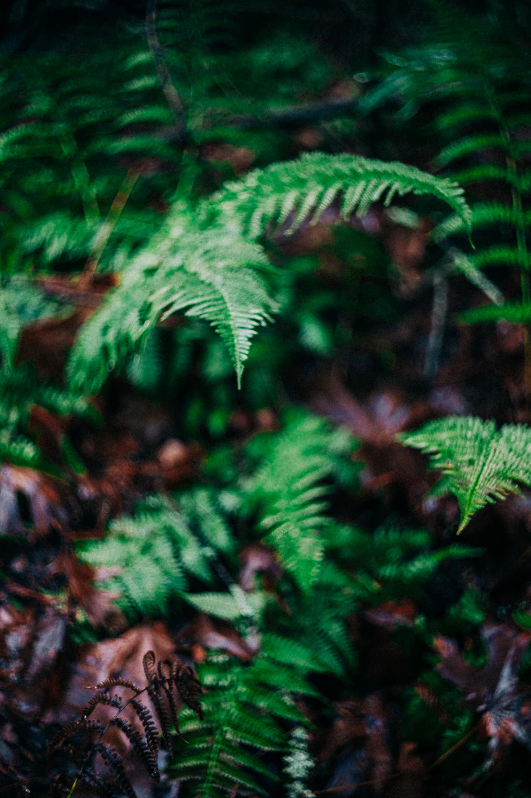
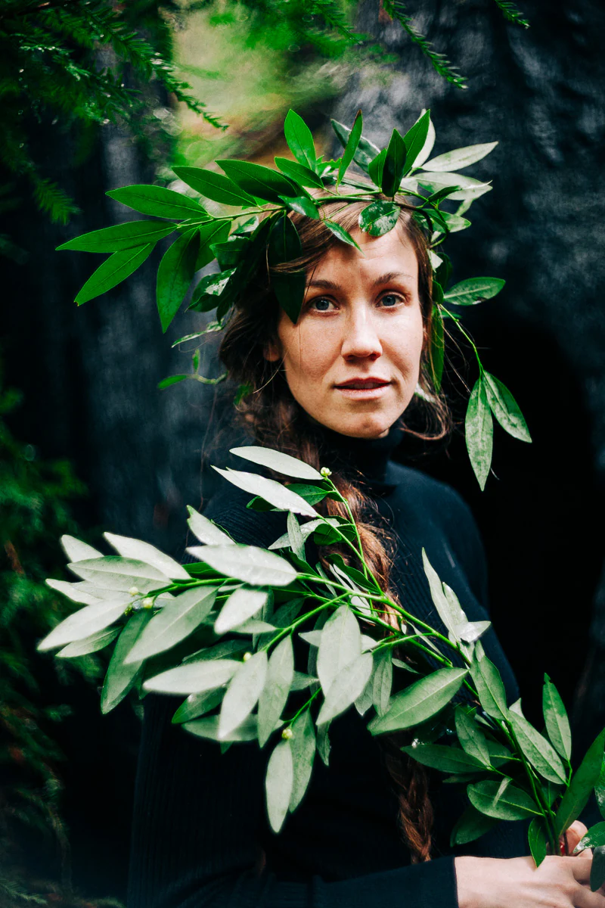
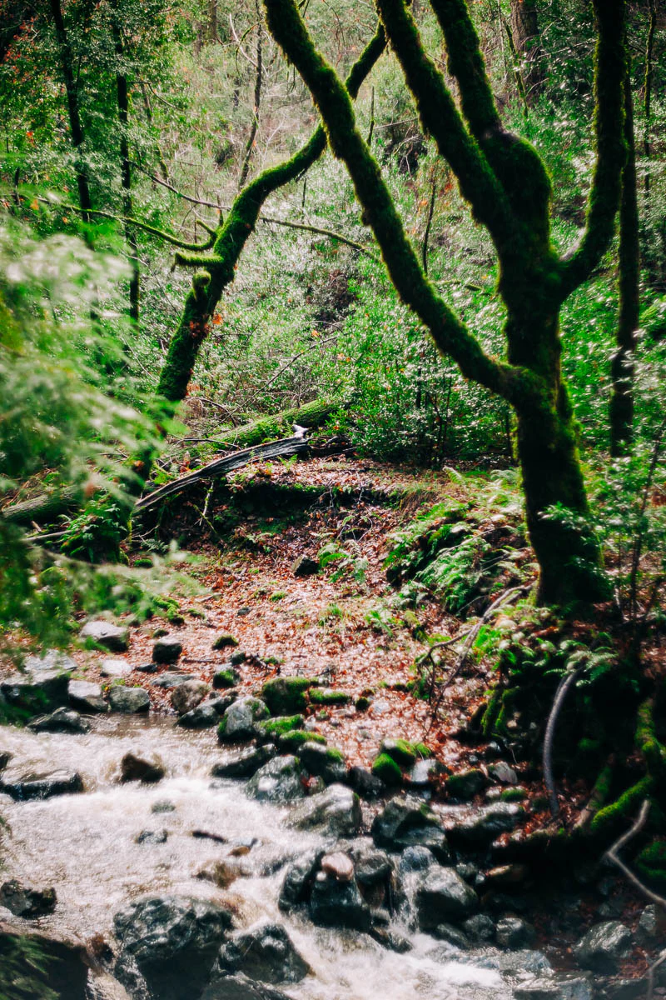

</figure>
