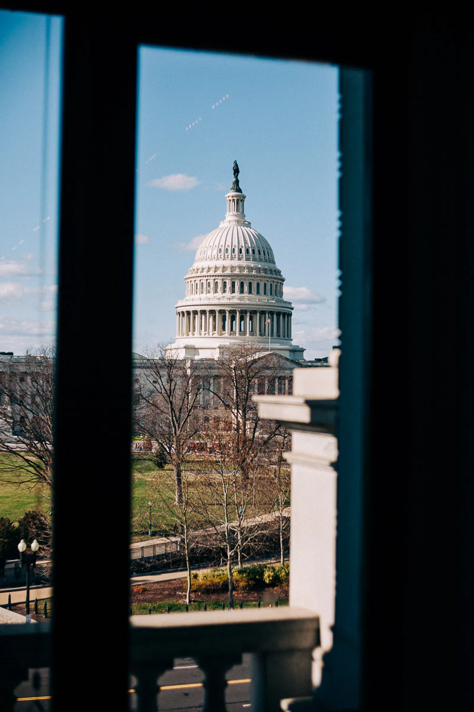
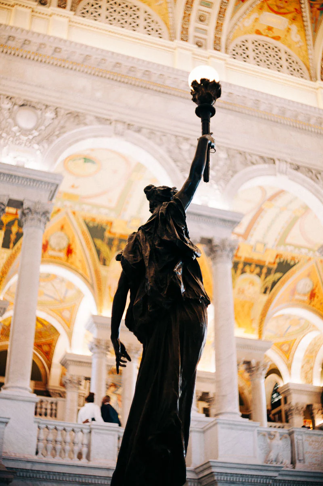
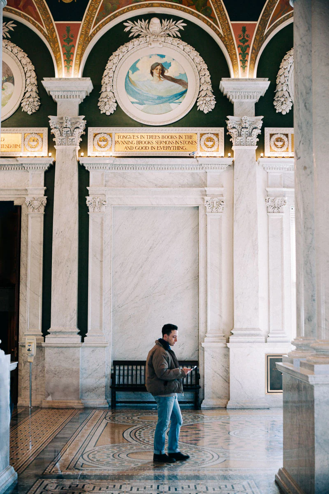
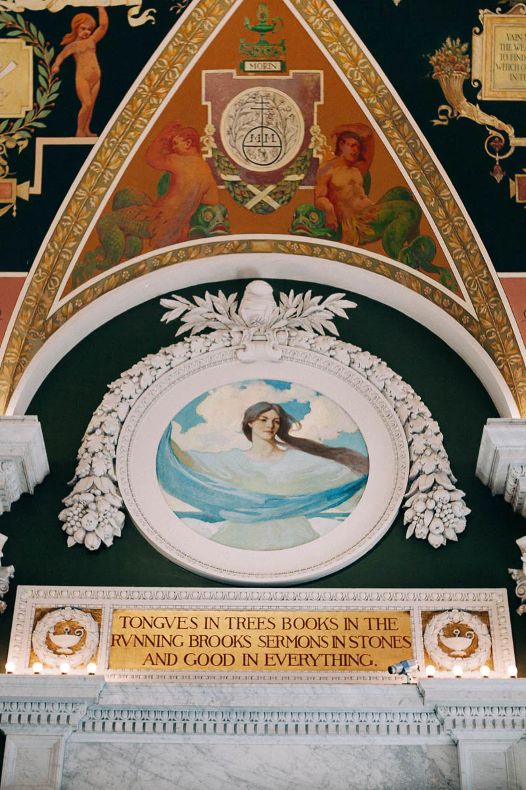
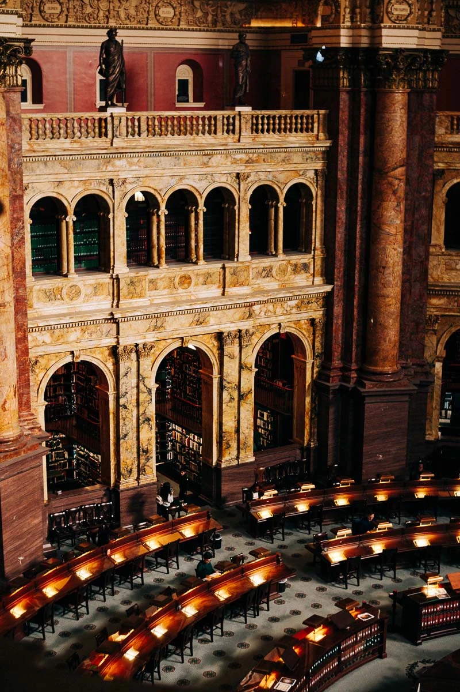
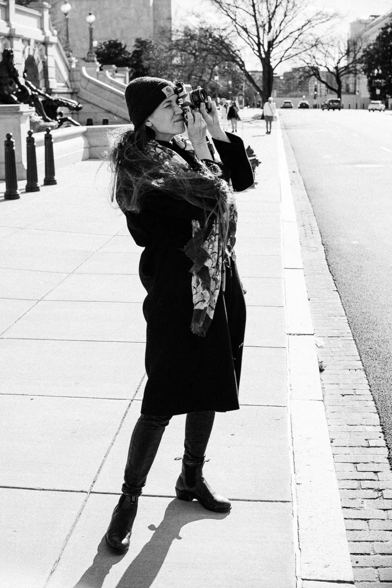
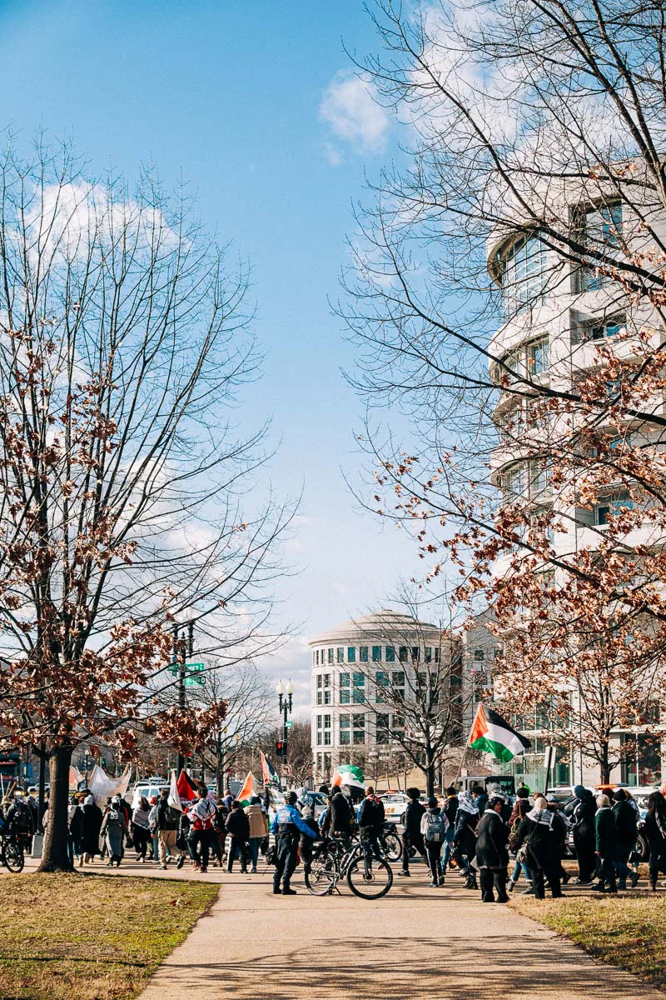
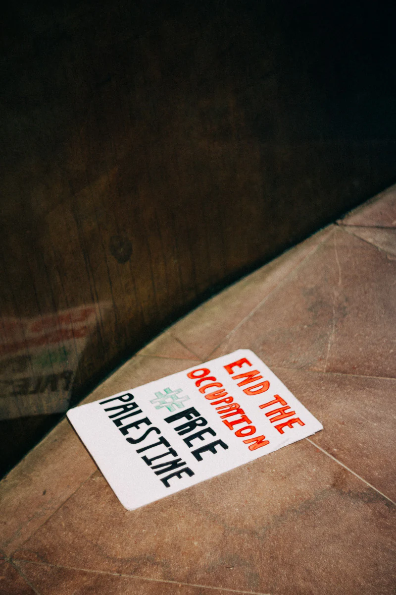
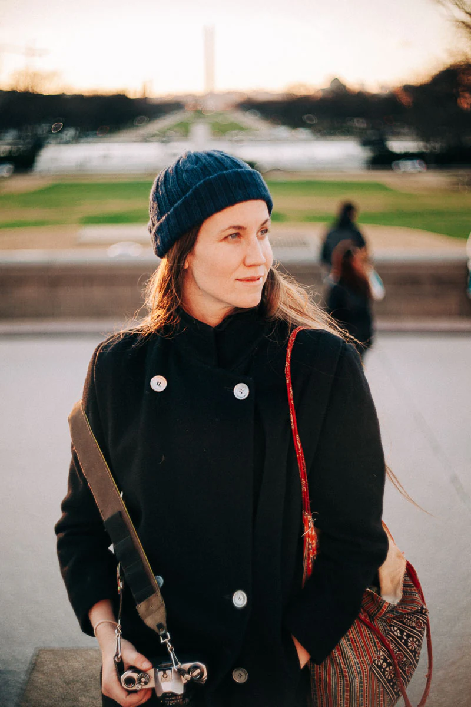

This January, I ventured back to Washington D.C., bracing for the winter chill but unprepared for the disenchantment I felt amidst the current political climate. It was a stark contrast to my first visit when I was a young bright eyed 8th grader. However, thanks to the incredible generosity of a friend who hosted us on Capitol Hill, we still managed to find pockets of enjoyment. This experience served as a powerful reminder of the importance of staying engaged in politics, even if it's just through simple acts like voting and encouraging others to do the same. Our friend's gift of hospitality, nestled right in the heart of the political landscape, proved to be an invaluable part of the trip, offering a welcome respite from the larger uncertainties and unrest.

<figure class="masonry">

</figure>