Spring is starting to show it's colors once again here in San Francisco, CA. It always comes at such as a lovely surprise seeing the bursting of new color and growth.

<figure class="masonry">
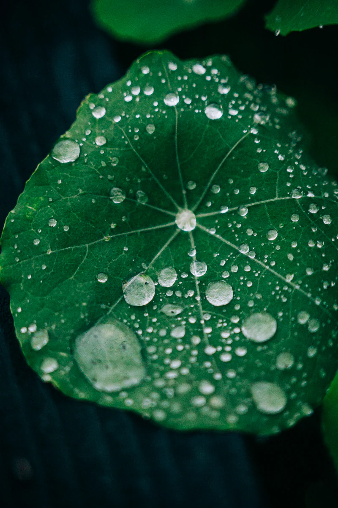
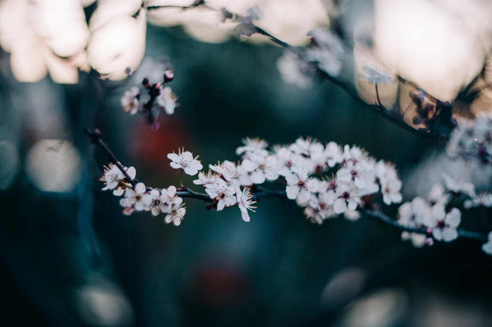

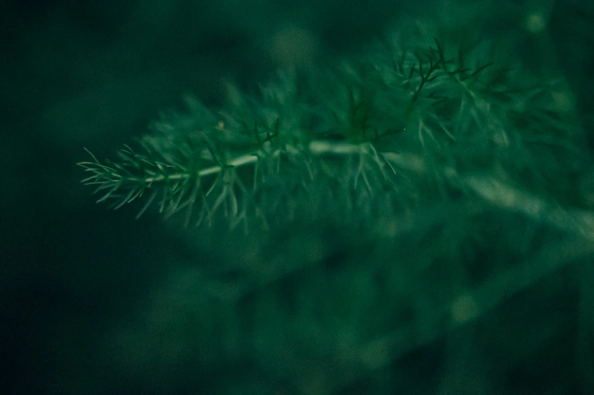
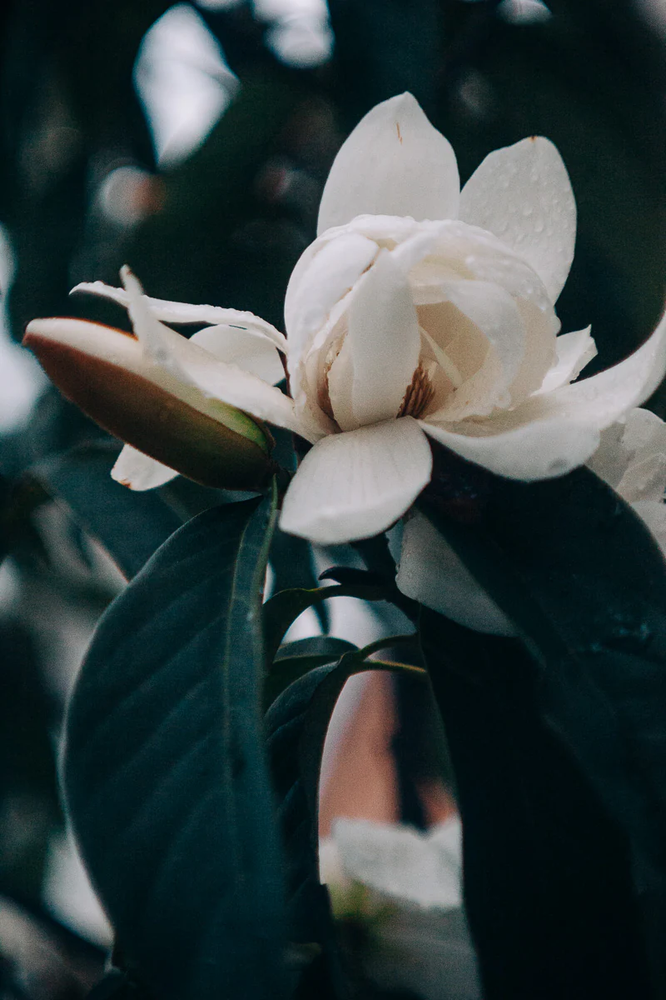

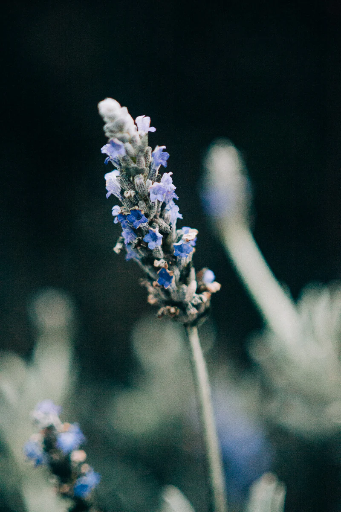
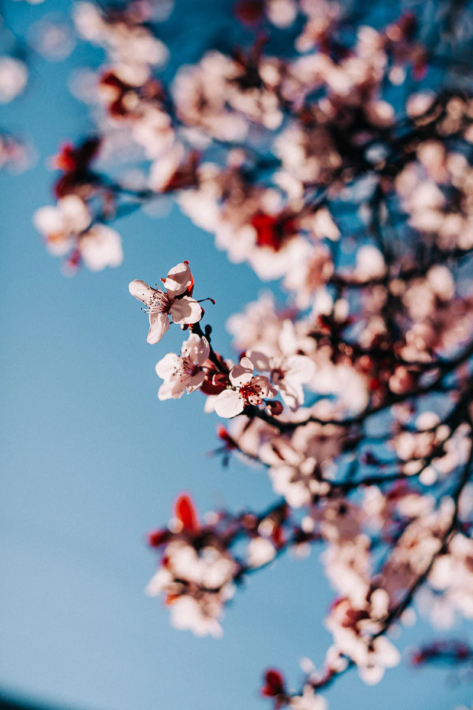
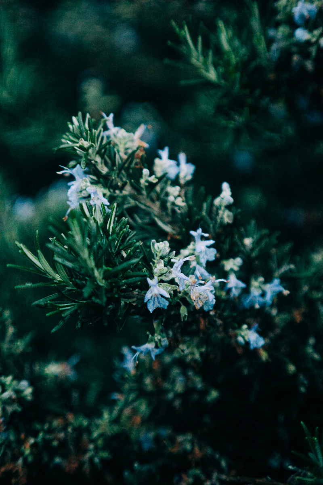
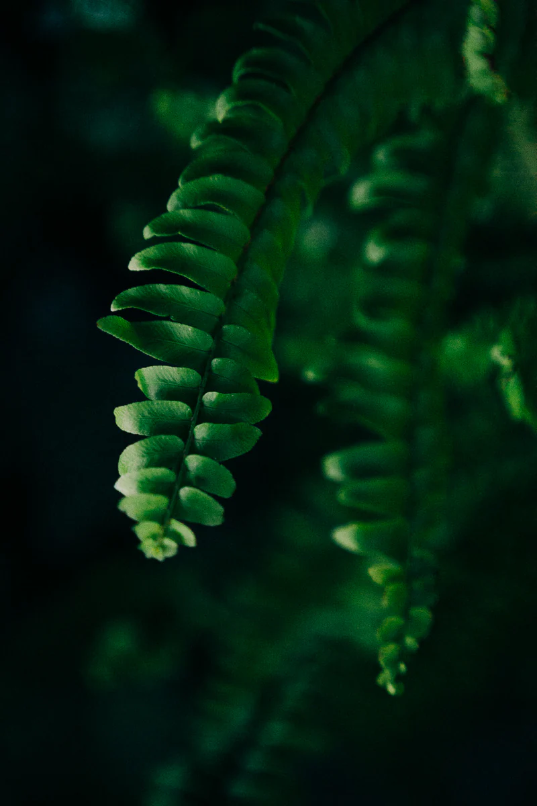
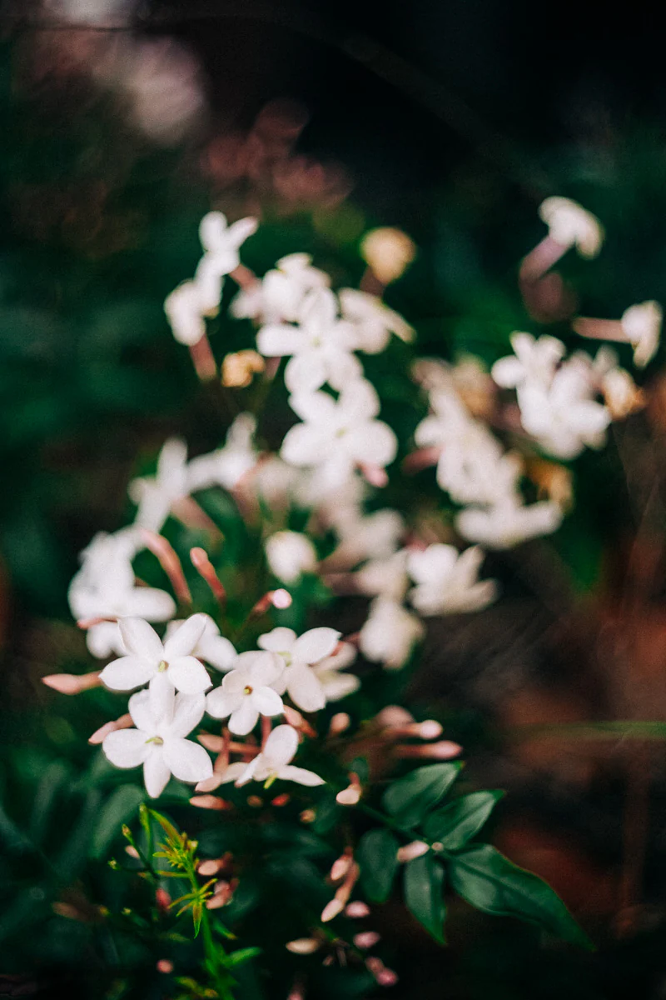

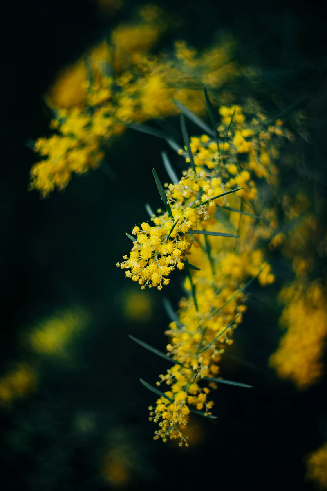
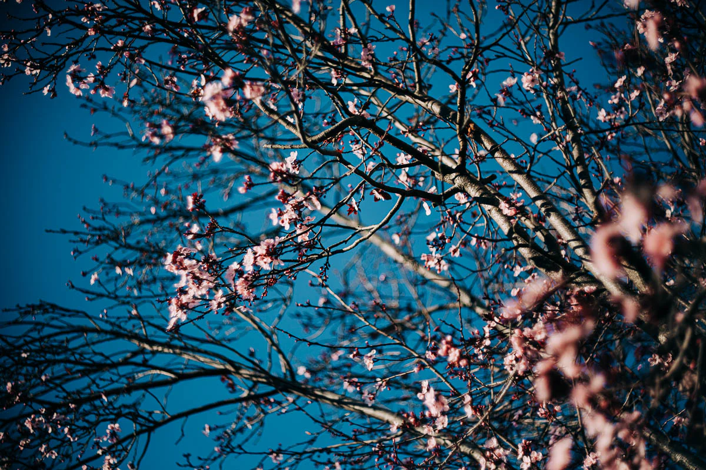
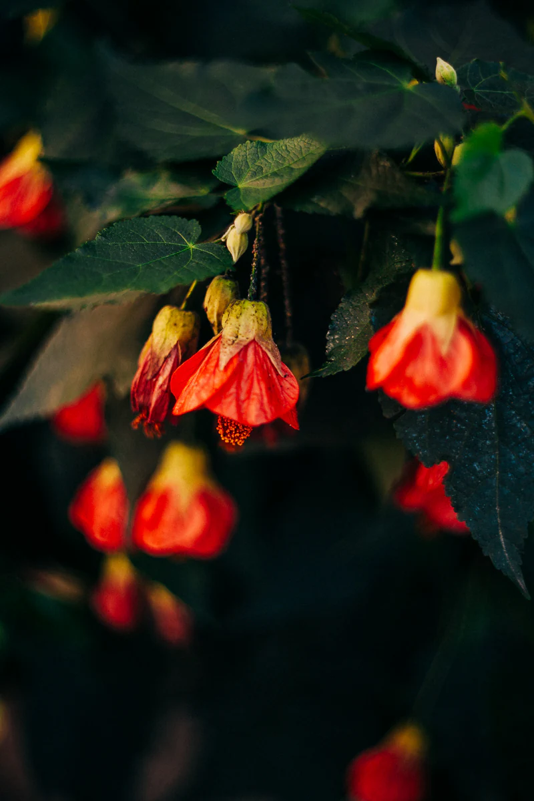
</figure>