This past fall, I embarked on a journey to Southern France for a memorable French wedding. Our itinerary included the city of Nîmes, the iconic Pont du Gard, and the charming town of Arles.

While the weather was a bit unpredictable, we enjoyed a delightful picnic in a local vineyard, savoring the regional wines and soaking up the autumnal atmosphere. Nîmes didn't quite live up to our expectations, but the other destinations were truly captivating. The Pont du Gard, an awe-inspiring Roman aqueduct, remains an engineering masterpiece. We marveled at its grandeur and enjoyed a leisurely stroll along the river.

Arles, with its rich history and artistic heritage, stole our hearts. We explored the Roman ruins, strolled along the Rhône River, and soaked up the unique atmosphere of the town. This trip was a feast for the senses, despite the occasional rain showers. We savored delicious local cuisine, enjoyed the fragrance of autumnal blooms, and captured the warm, soft light of the fading sun in our photographs.

<figure class="masonry">
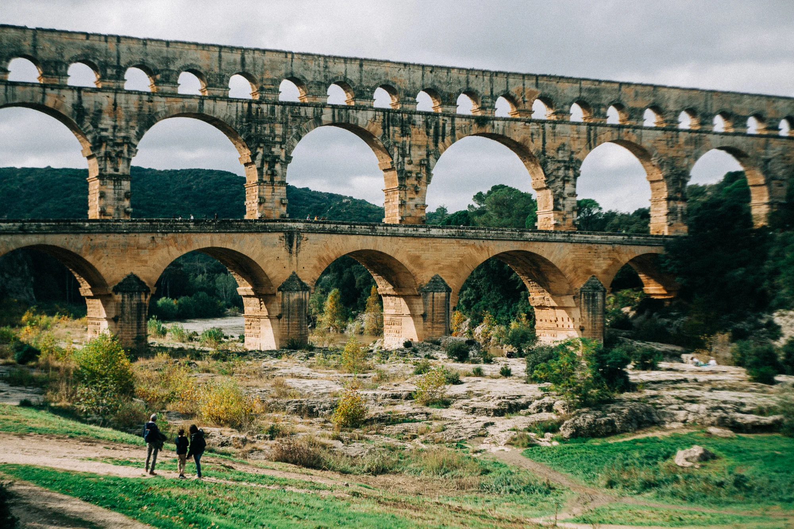
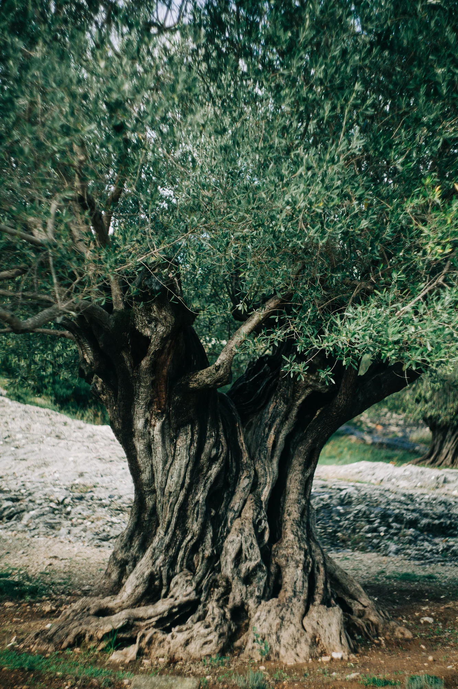

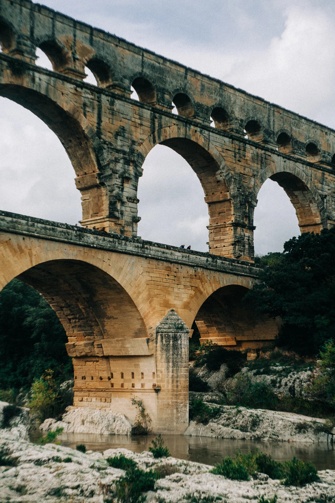
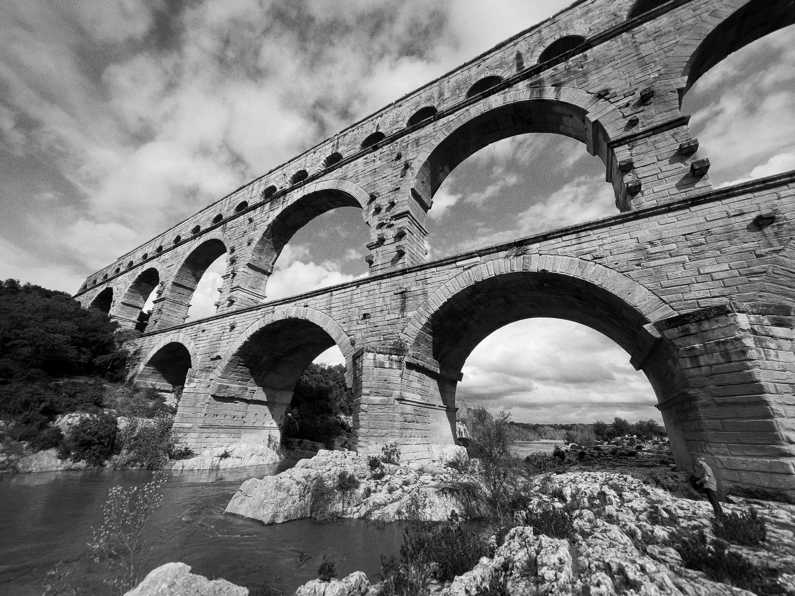

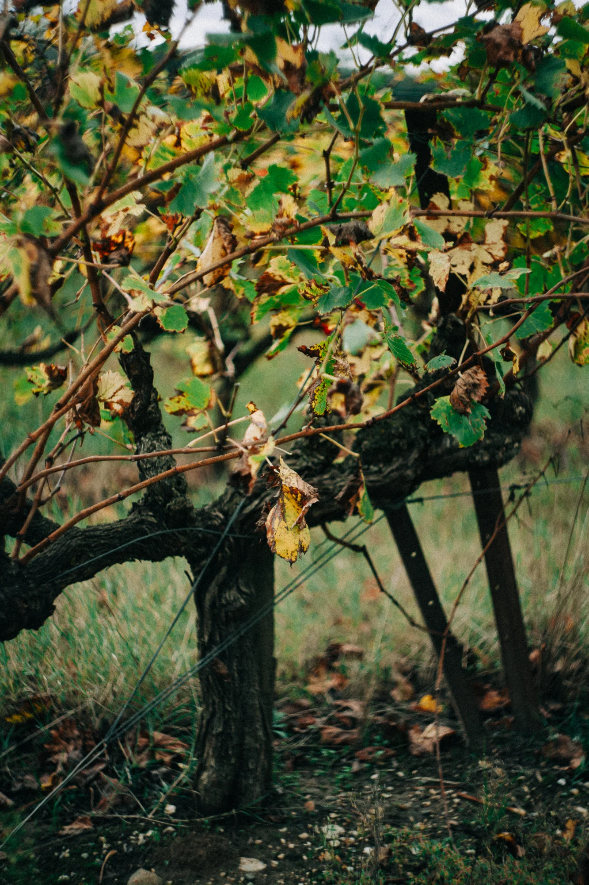
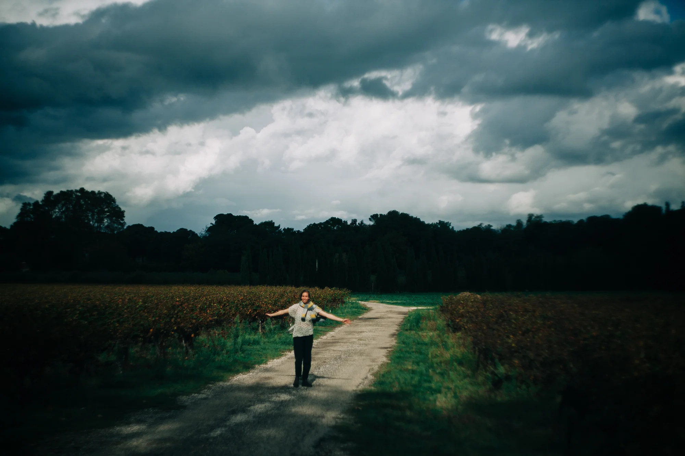

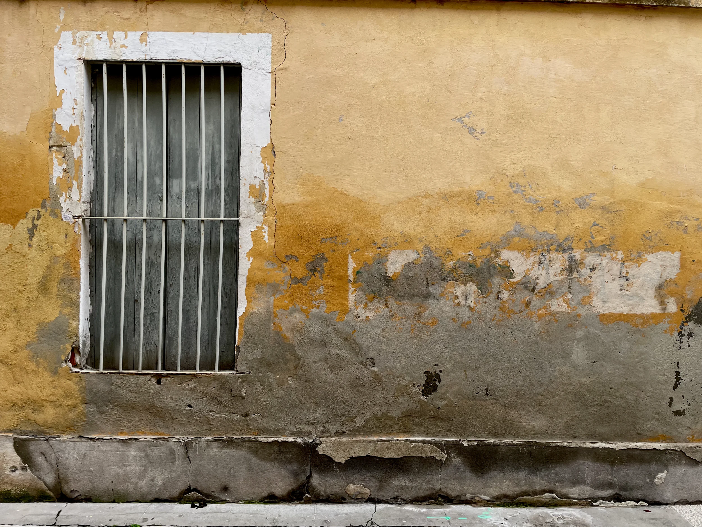

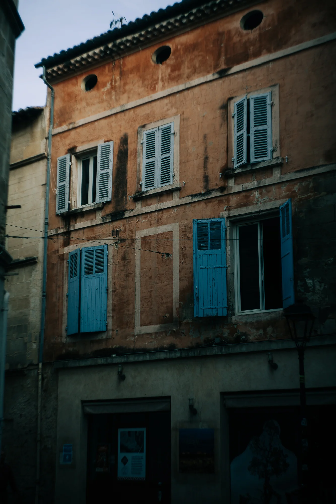
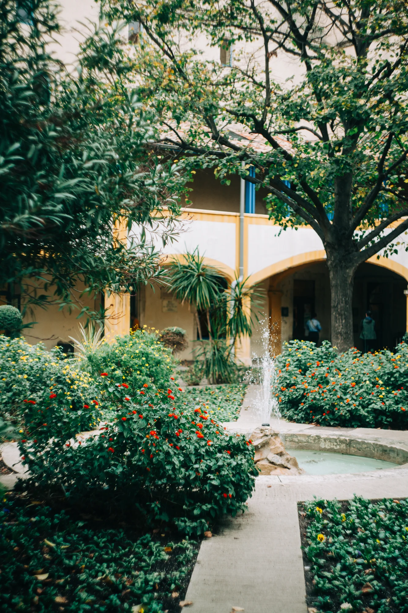

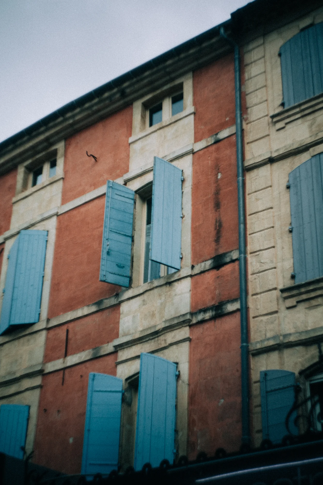
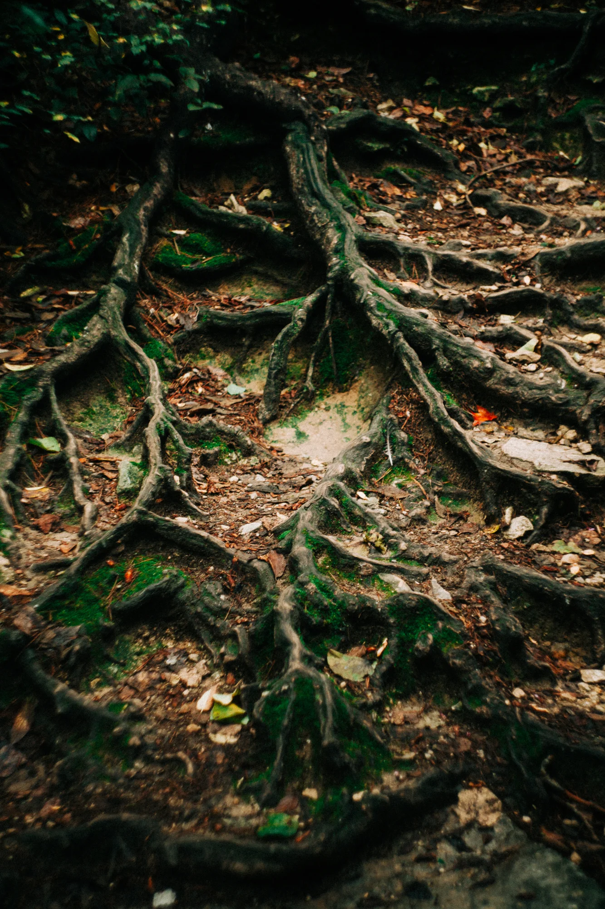

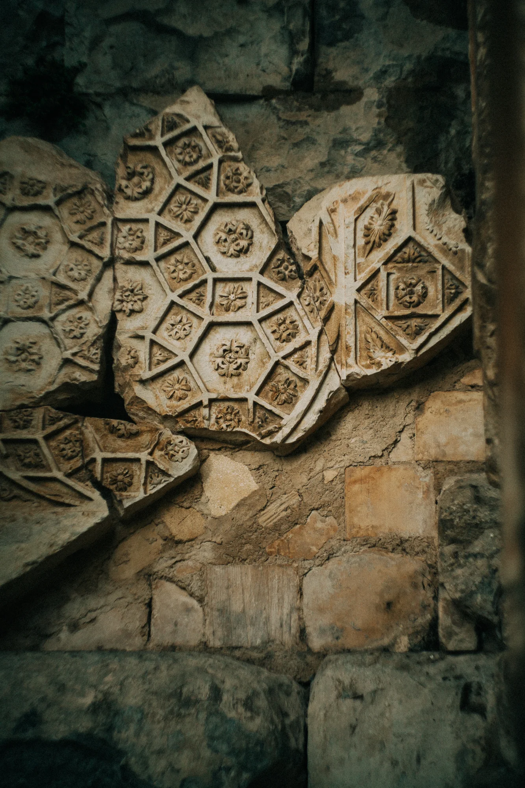
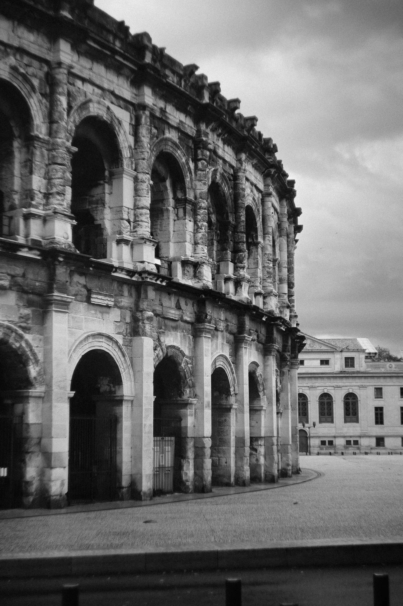
</figure>
