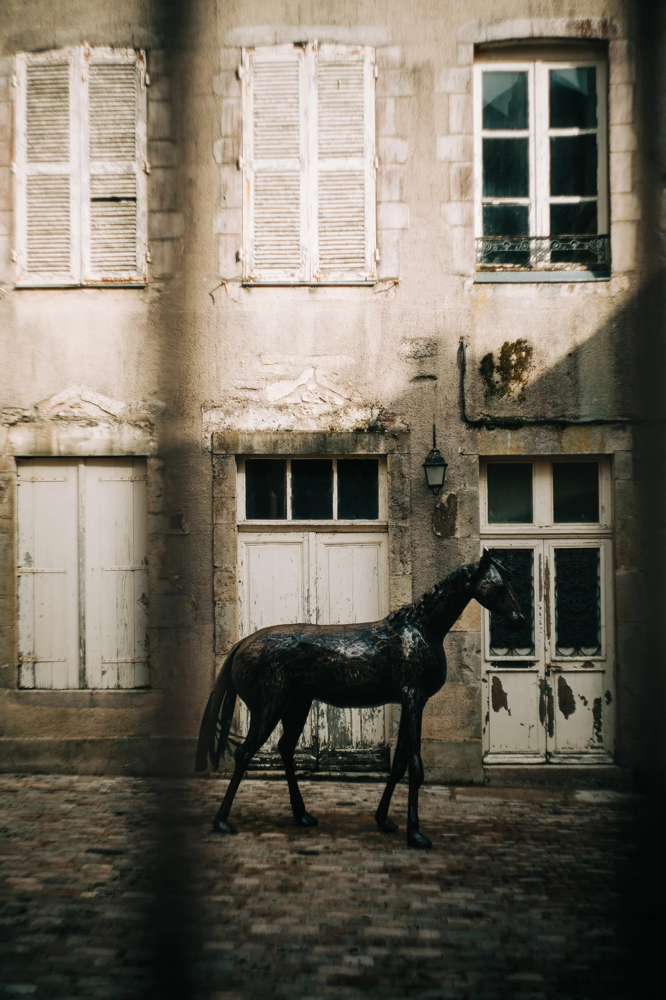
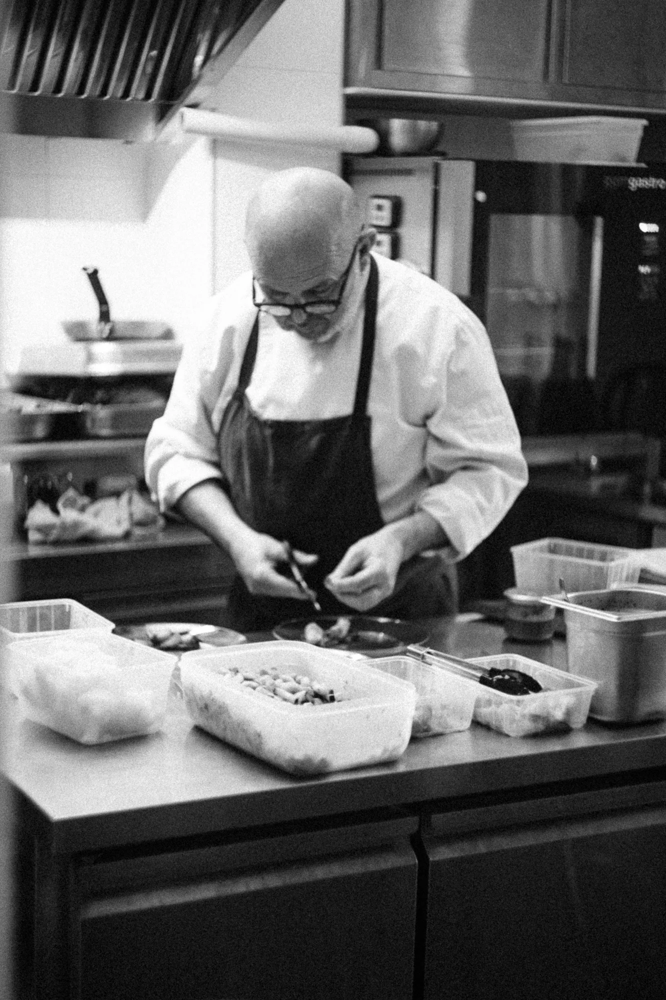
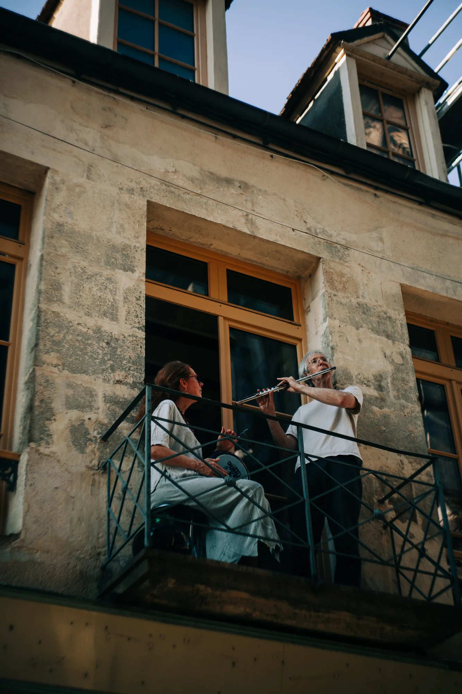
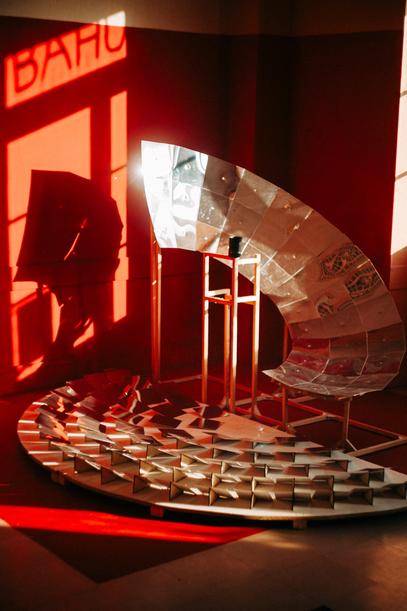

Highlights from June: The month featured a superb dinner at Cuisine à Vue in Vézelay, the street-side celebrations of the Fête de la Musique, and an event honoring Augustin Mouchot, the man who pioneered the solar engine. Not a bad start to summer!
<figure class="masonry">

</figure>
