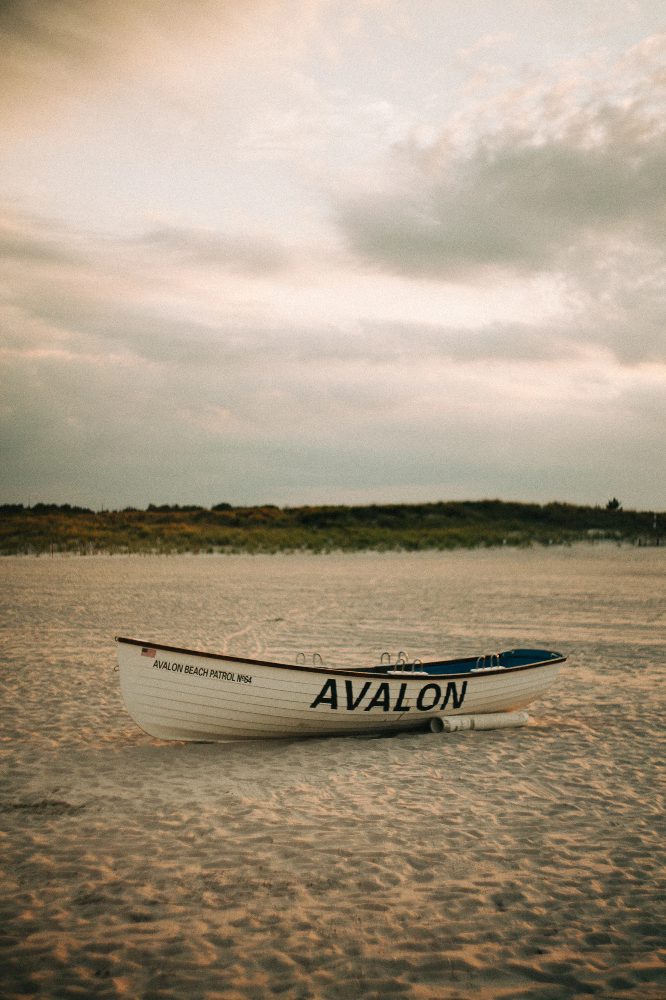
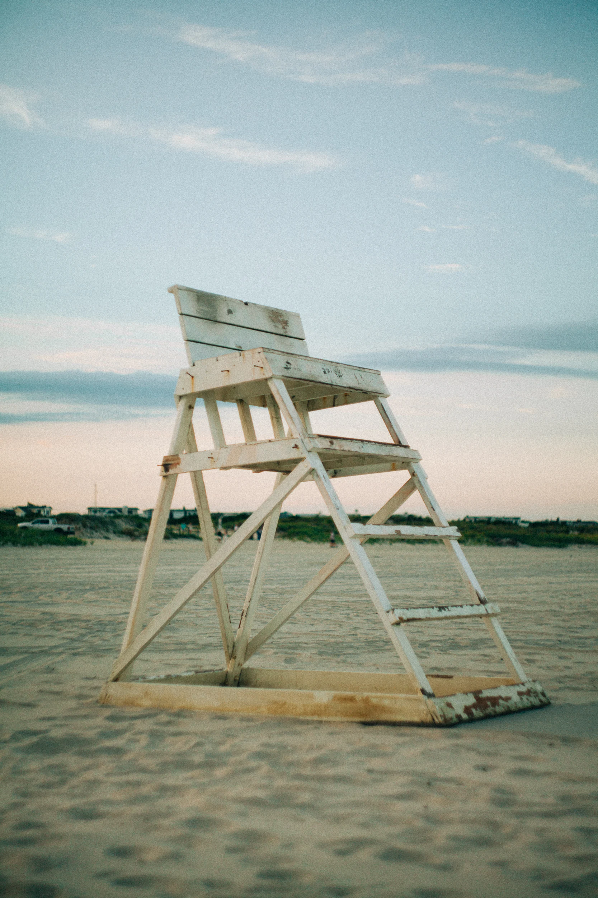
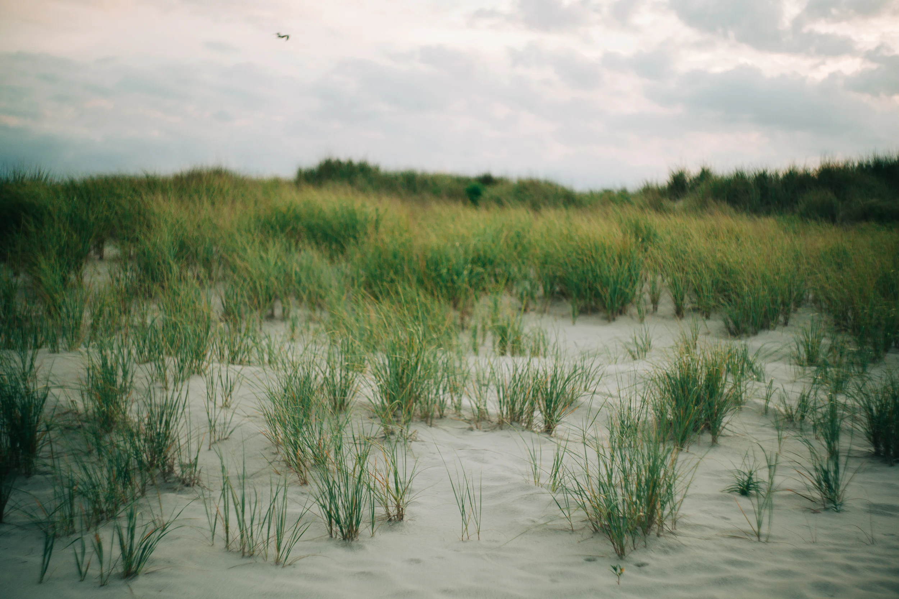
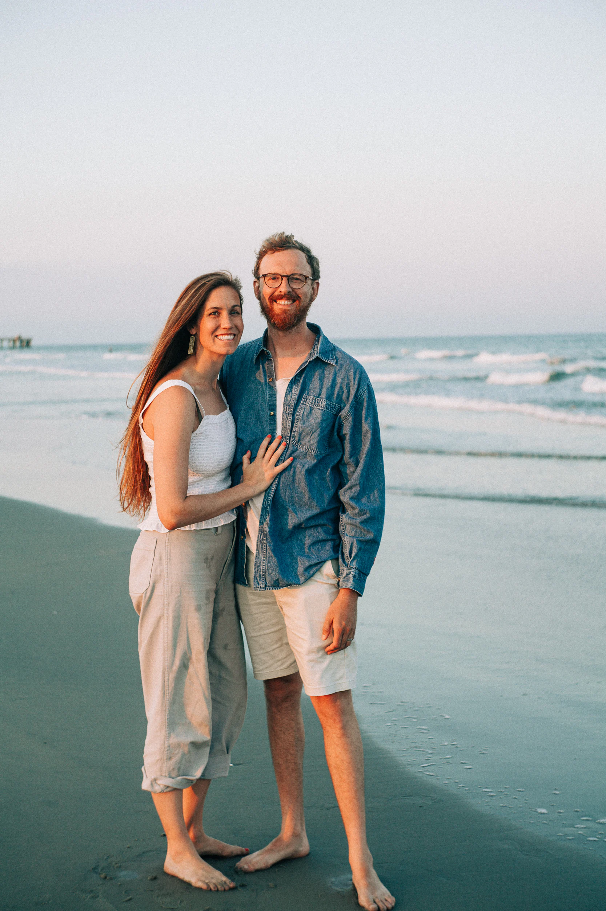
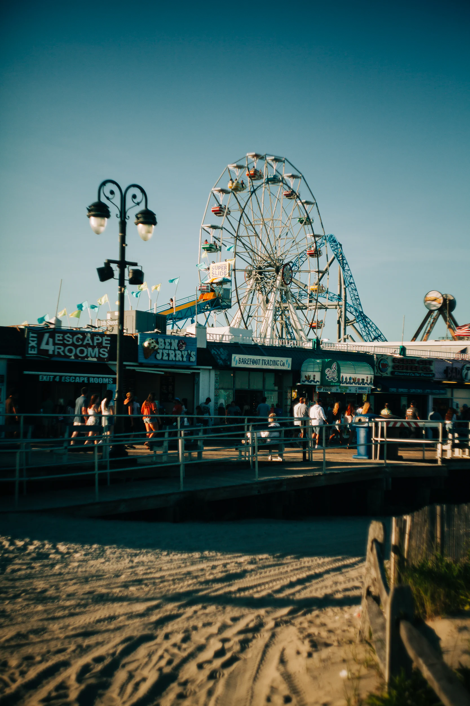
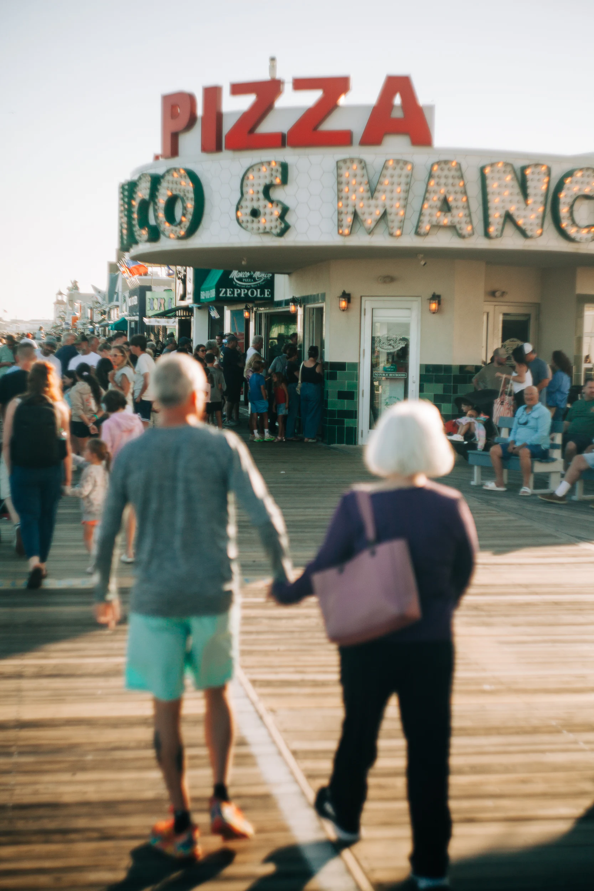
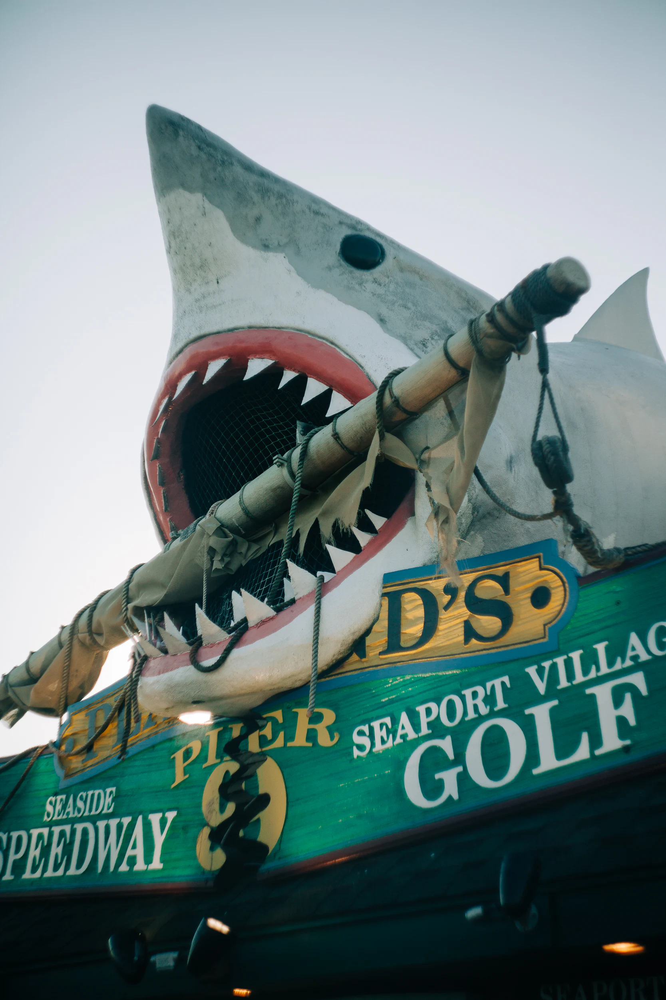
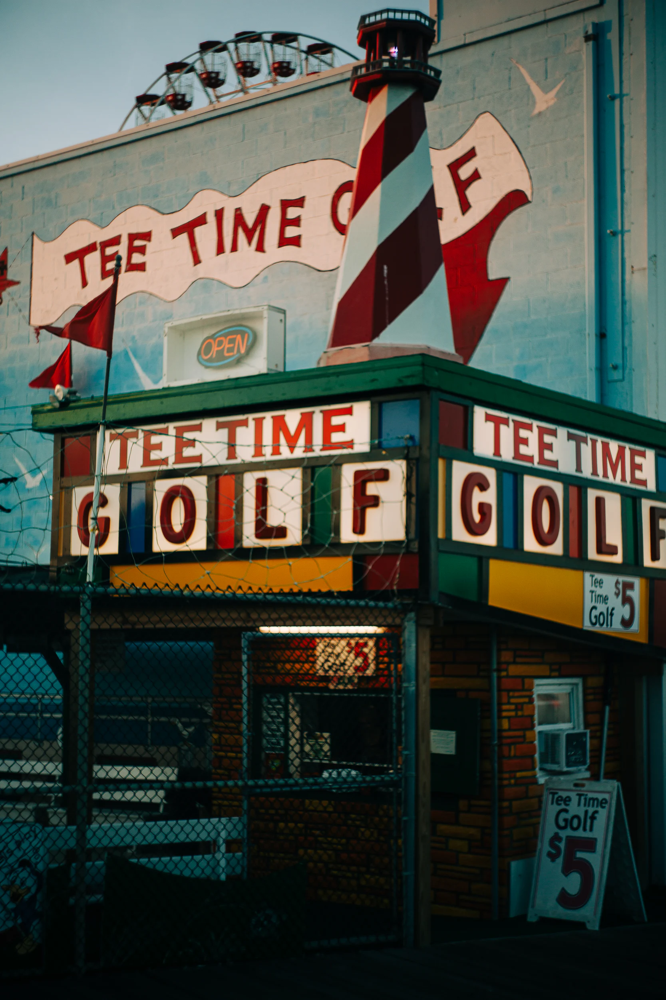

Highlights from July: A lovely trip to Avalon, New Jersey with the fam. We enjoyed hours on the beach, boogie boarding, a few strolls on the boardwalk, and the most magical sunset on the dunes. It was the perfect classic summer getaway.

<figure class="masonry">

</figure>