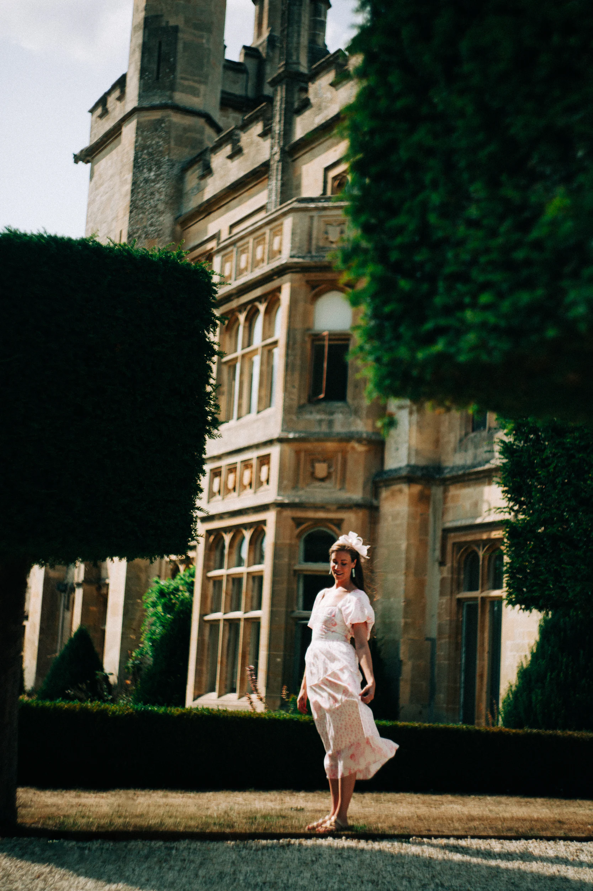
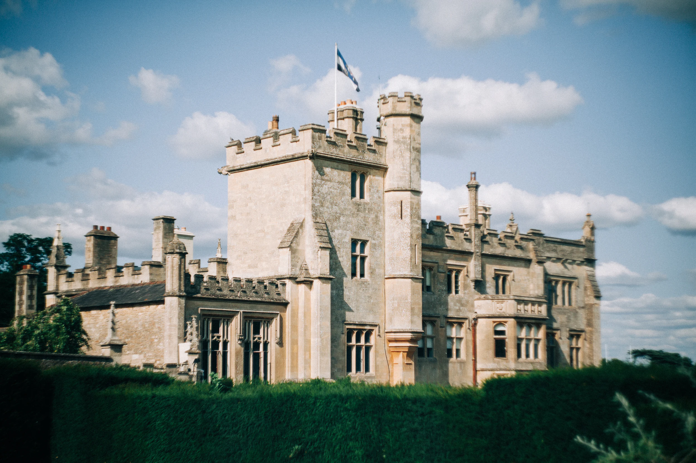

A lovely trip to Bath, England for a wedding. It was a magical visit surrounded by incredible English countryside, filled with vibrant colors, lush gardens, and interesting people.
<figure class="masonry">

</figure>