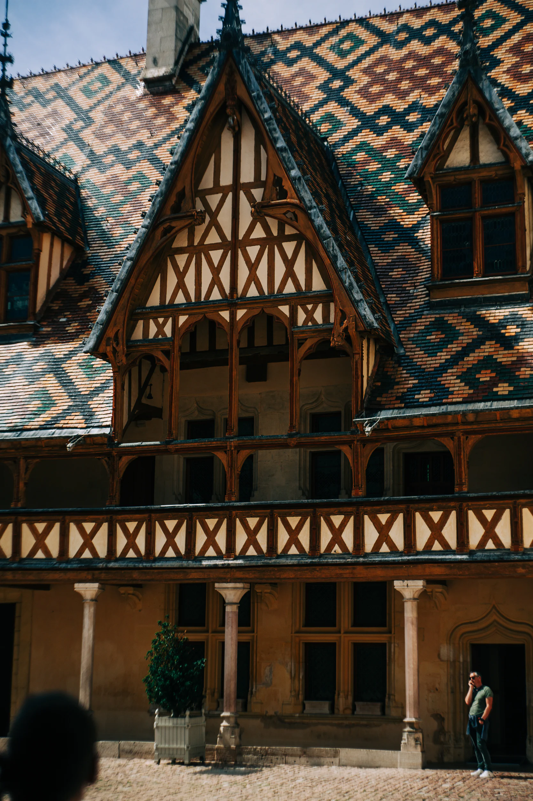
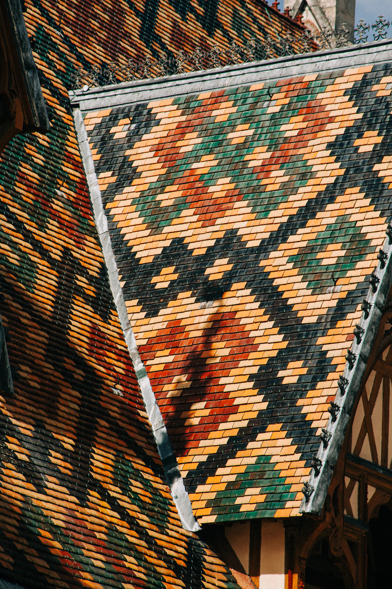
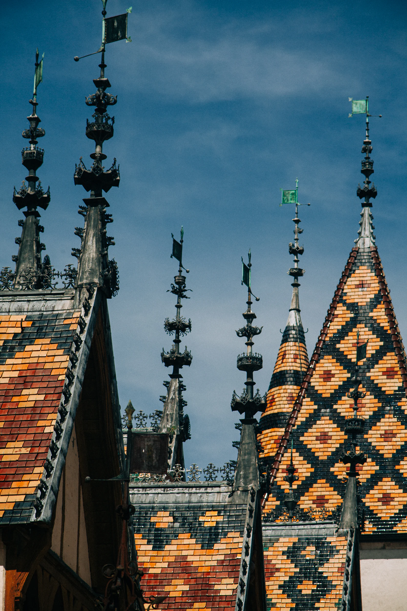
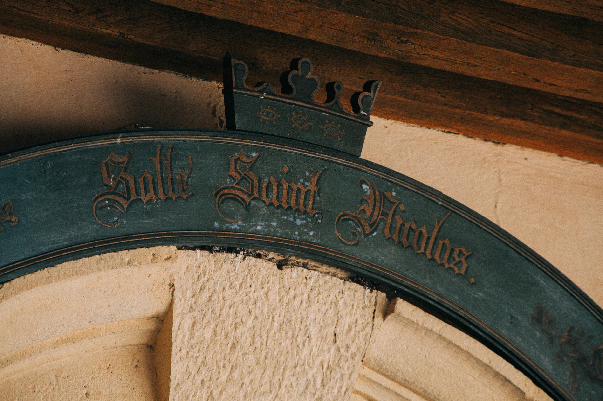
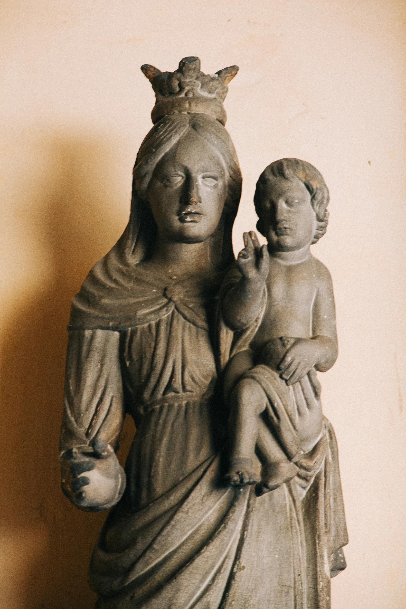
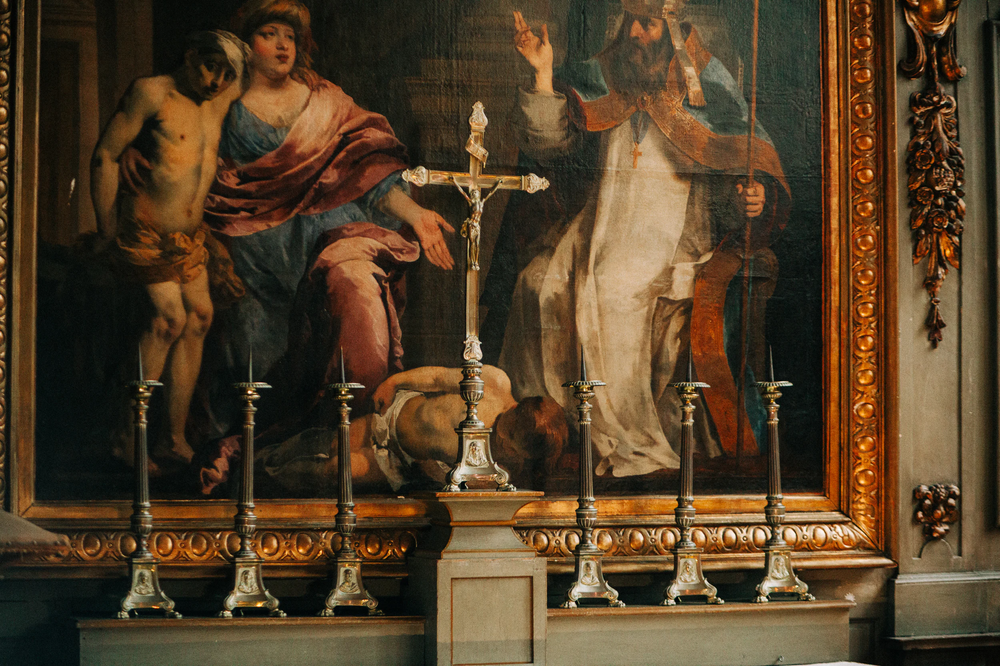
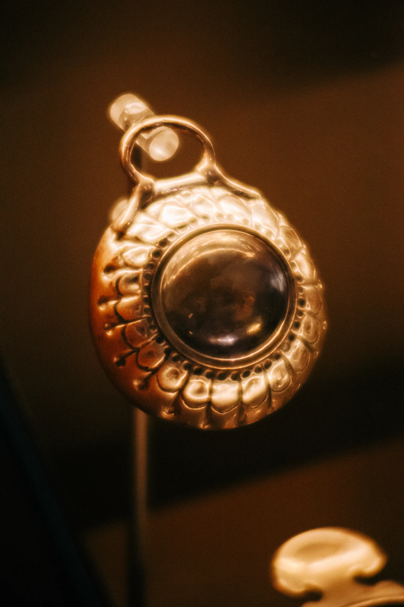
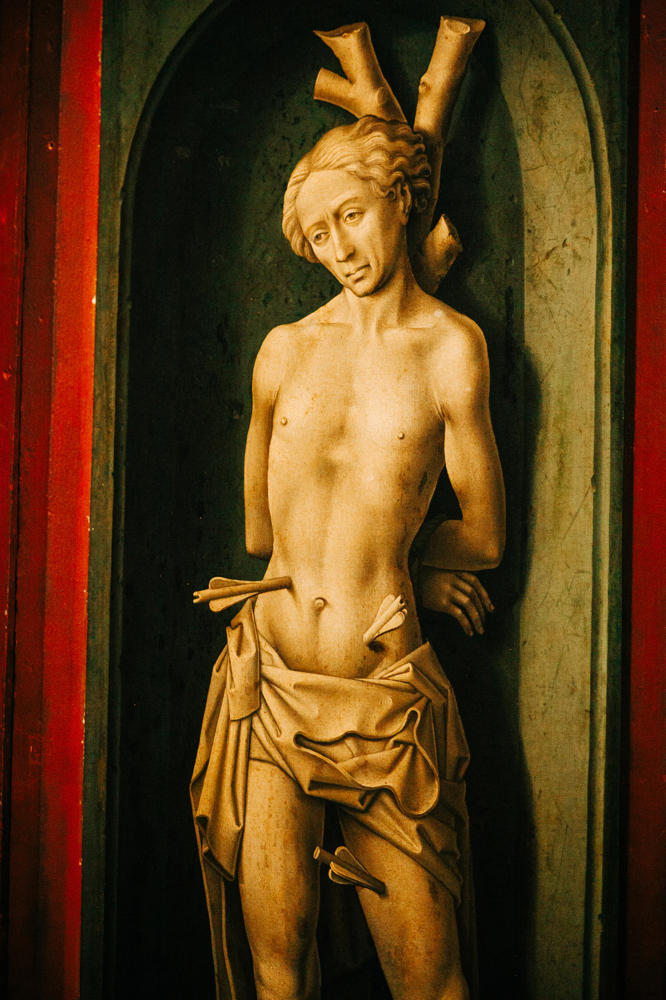

A lovely trip to Beaune to see the historic Hospices de Beaune. This medieval hospital is a must-see for anyone visiting the area. The multi-colored tile roof is stunning, and the interior is an important site for both art and the history of medicine. I love all the ancient details, especially the gothic typography spread throughout the building—particularly in the apothecary.
<figure class="masonry">

</figure>
