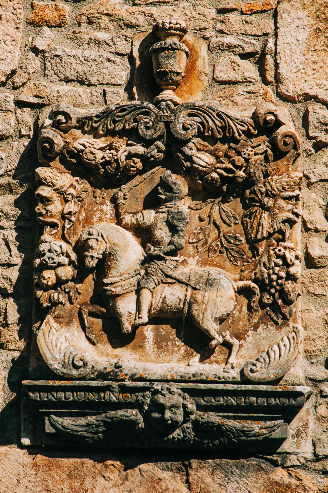
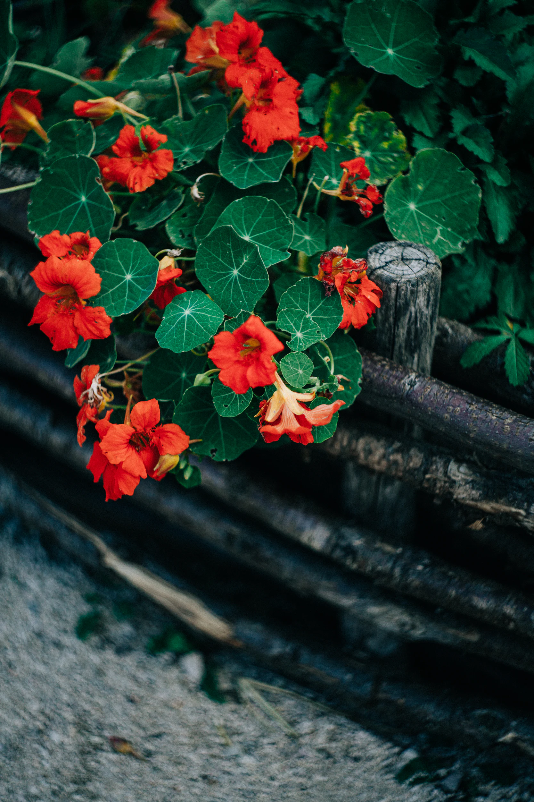
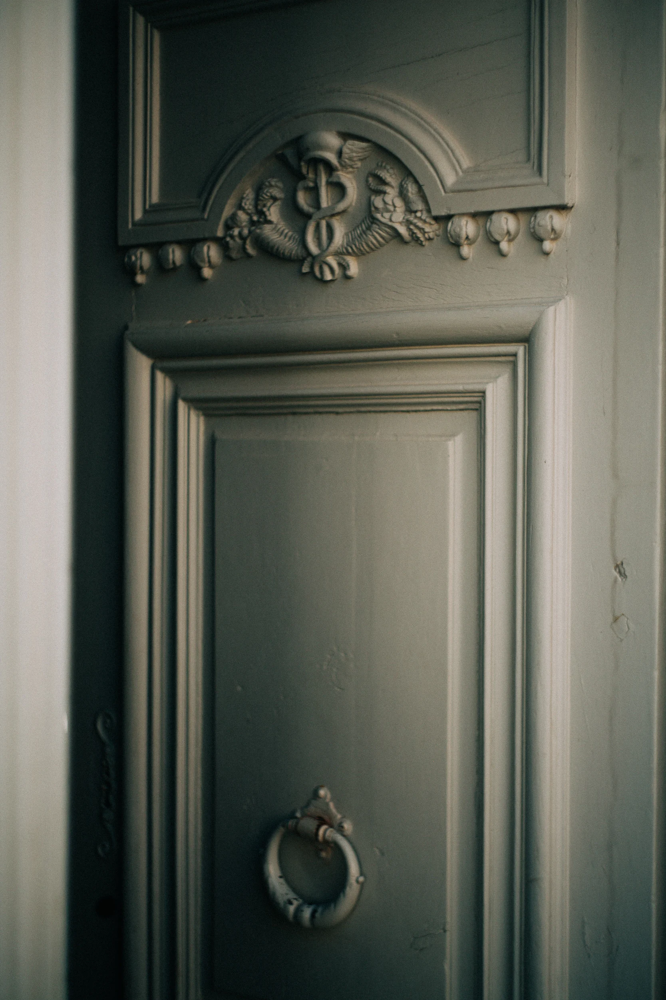
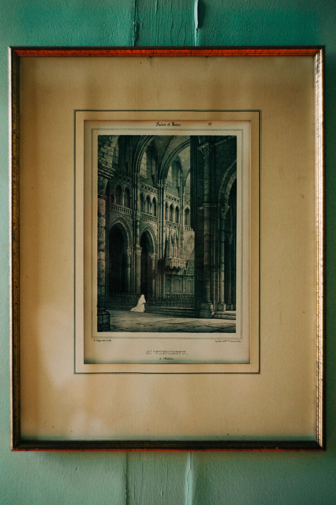
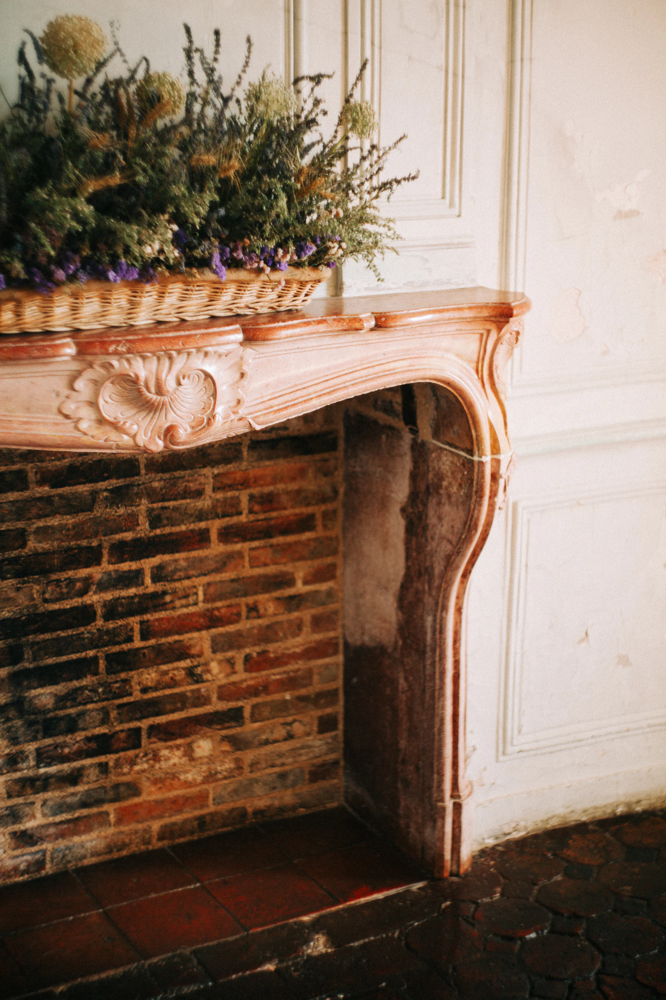
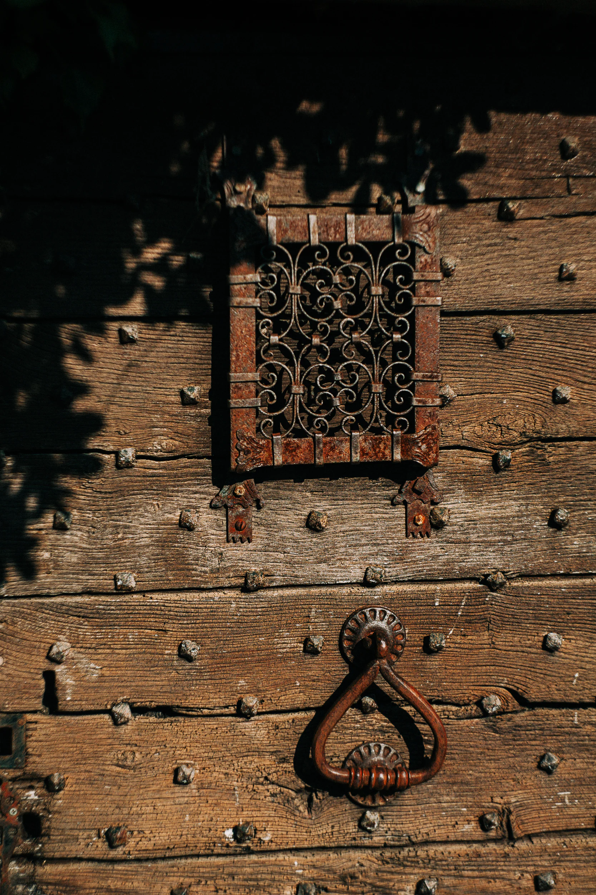
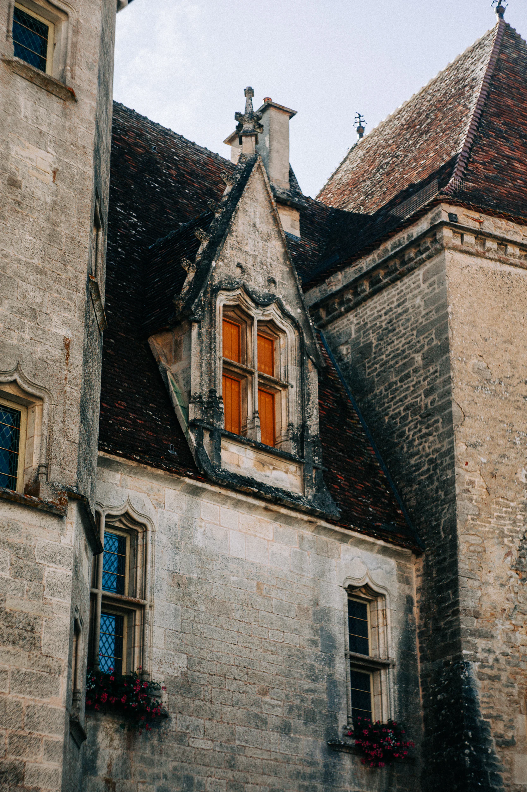
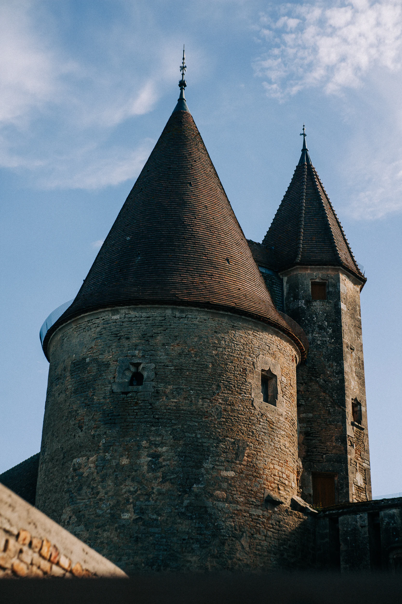

Châteauneuf-en-Auxois is a charming medieval village in Burgundy, France. It's perched on a hilltop and offers stunning views of the surrounding countryside. The village is known for its well-preserved castle, which dates back to the 12th century. It has undergone massive renovation and is well worth a visit. Enjoy a few details from the castle.
<figure class="masonry">

</figure>