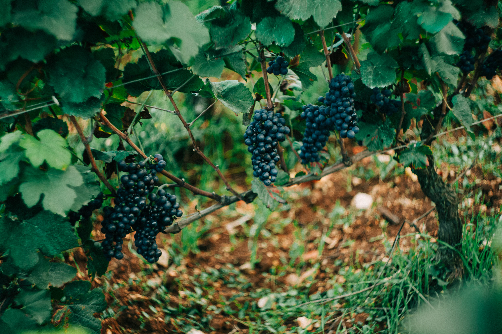
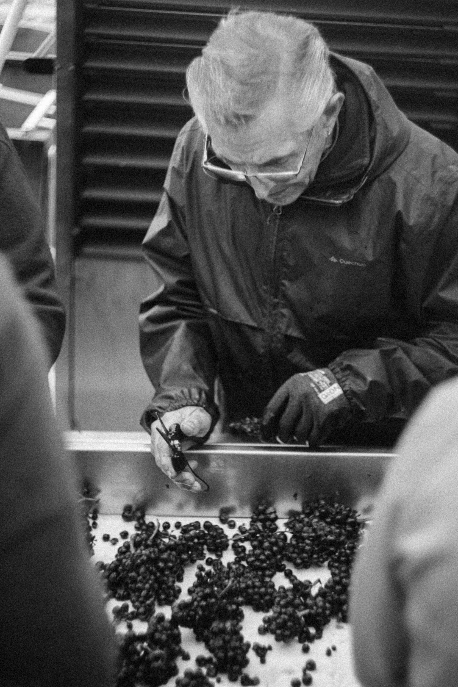
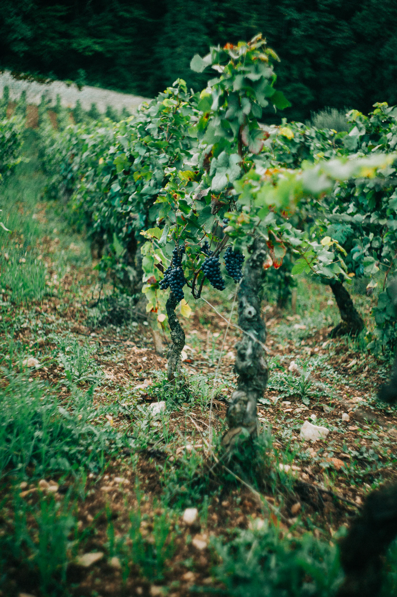
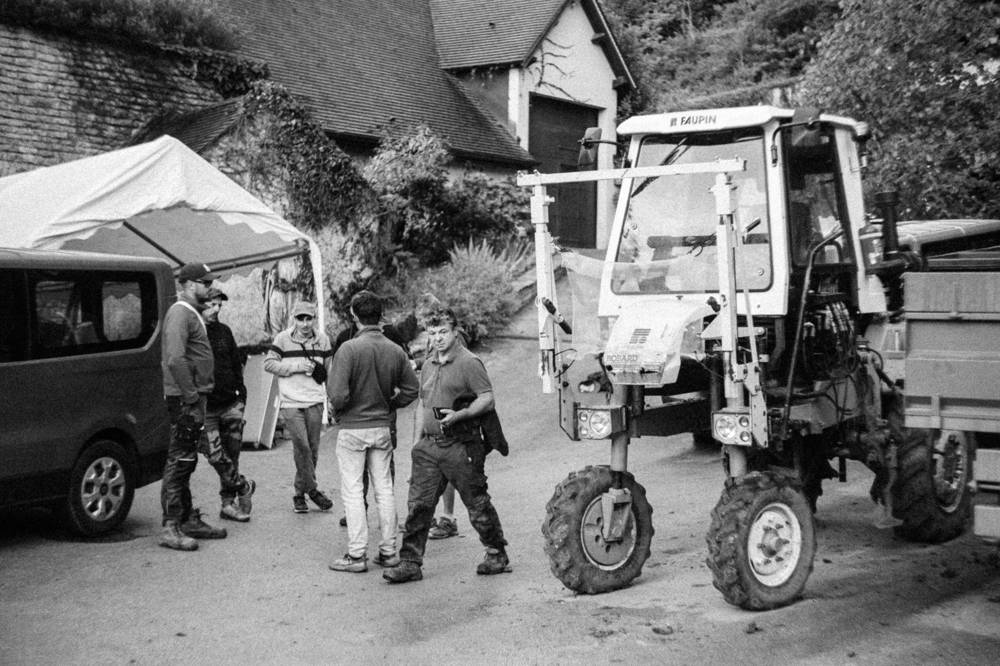
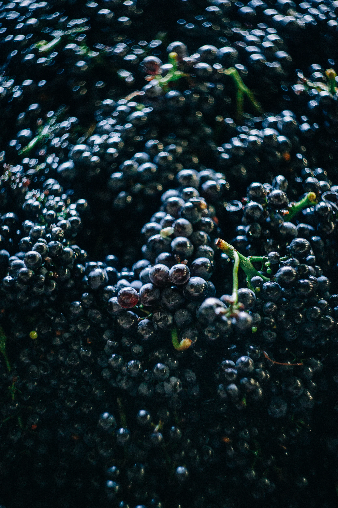
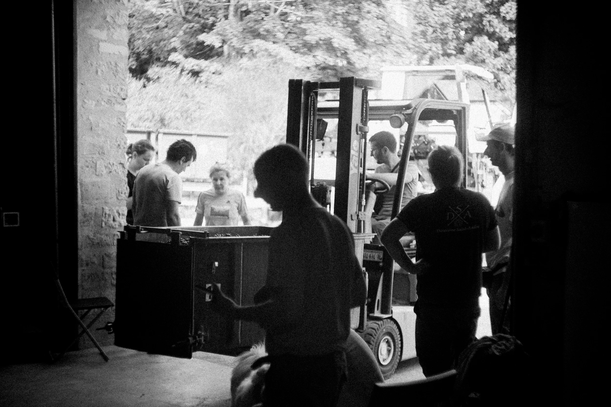
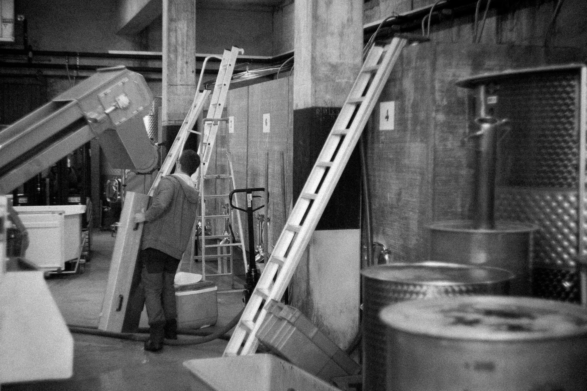

What a wild week doing *vendange* in Chambolle-Musigny, in the heart of Burgundy. It was probably the hardest work I’ve ever done, but also an experience I’ll cherish for a lifetime. As a lifelong learner, getting to pick grapes in France and then seeing them get crushed and fermented was a bucket-list moment for sure. We even got to open a bottle from 1934, and remarkably, it had held up. It felt like time traveling—suddenly I found myself thinking about the people who worked that harvest nearly a century ago and turned those grapes into wine. Now, each bottle will taste a little more special knowing the laborers, artisans, and friendly dog who helped make it happen. 

*Santé!*

<figure class="masonry">

</figure>
