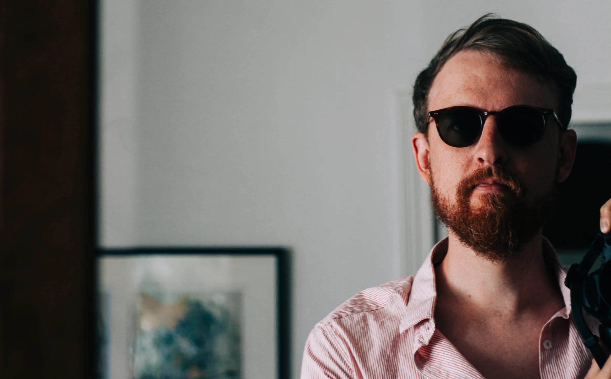

# {{ page.title }}
Lundblad Studios is a multidisciplinary atelier led by Peter Lundblad. He is driven by curiosity and admiration. By day, he freelances as an art director. By night, he moonlights as a photographer and poet, often merging the two and allowing one medium to inform the other. He is fascinated by the lyrical qualities of dusk and the rhythm of an imperfect lens.

Hailing from Santa Rosa and being a fifth-generation Californian, he is enthralled by the natural realm. He spends his limited free time cycling, baking, and dreaming.

<section>
    
</section>

